# Project Volam

A small, working **multiplayer top-down 2D RPG prototype** – the seed of an MMORPG – built with
**Godot 4.2.1** and **GDScript**. The art is Kenney's public-domain (CC0) pixel art; see
[CREDITS.md](CREDITS.md).

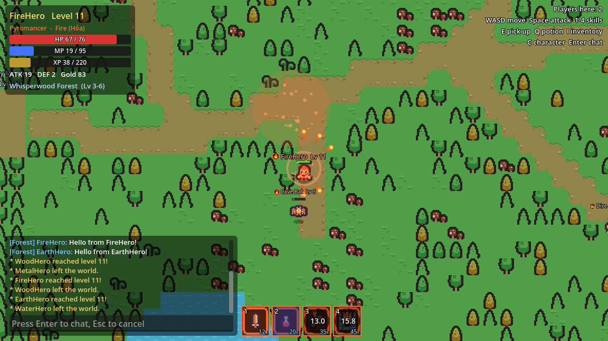

| Whisperwood Forest (Lv 3-7) | Bone Crypt (Lv 6-11) | Frostpeak Ruins (Lv 9-13) |
|---|---|---|
| 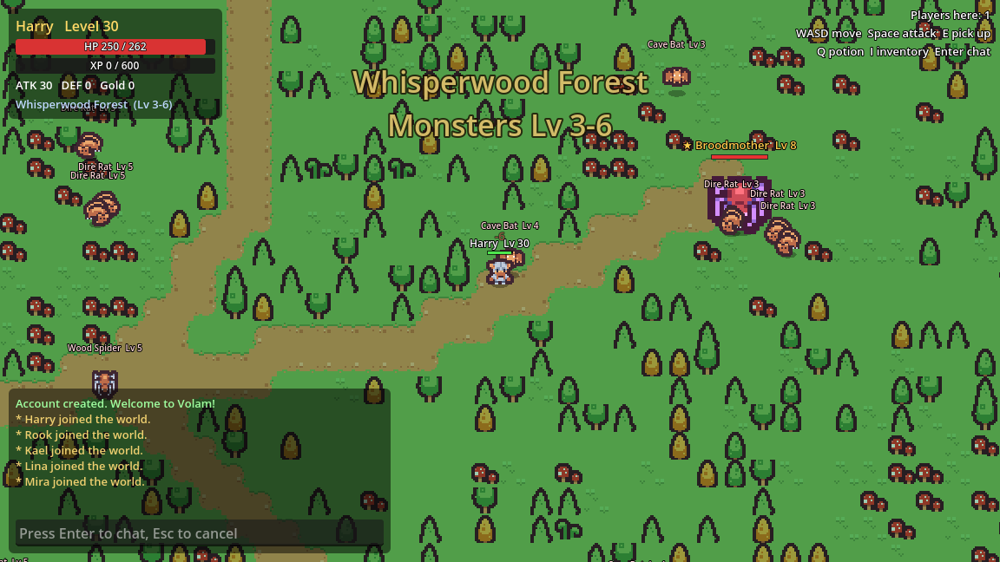 | 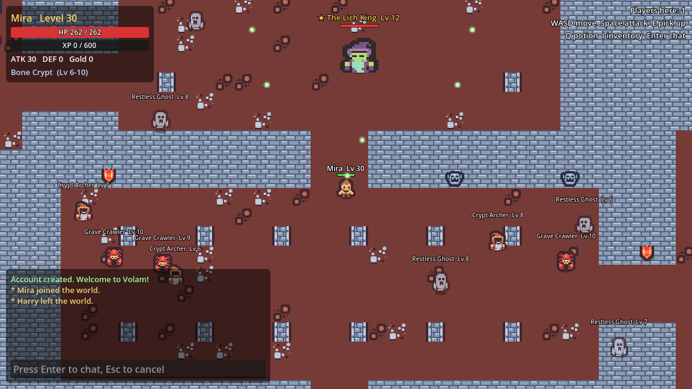 | 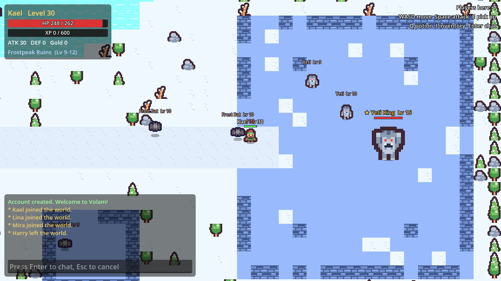 |

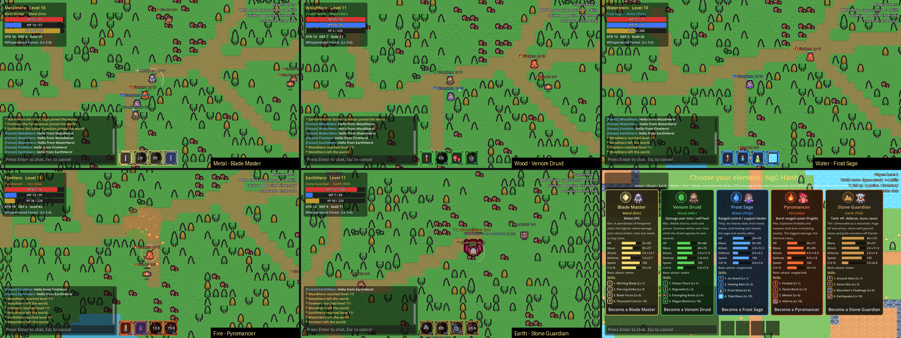

## What's in it

| Feature | How it works |
|---|---|
| Host / Join / Dedicated server | One project. The main menu has *Account name*, *Password*, *Server address* (default `127.0.0.1`), **Host (listen server)** and **Join**. Run with `--server` for a headless dedicated server. ENet (UDP) on port **7777**. |
| World & zones | Four big open-world zones, each a **200×128** tile map (32 px tiles, 10× the area of the original 64×40 maps) built from Kenney's CC0 pixel art from a fixed seed, so every machine builds the same maps: **Sunny Meadow** (starter town + wilds), **Whisperwood Forest**, **Bone Crypt** and **Frostpeak Ruins**. Monsters live in **groups** (packs, camps, elite packs, patrols, boss guards) that get tougher the farther you go from the zone entrance; a **minimap** and a full zone map (**N**) keep you oriented. Glowing portals at map edges link the zones. A banner shows the zone name when you enter, and the HUD always shows the current zone. Walls, water, trees, tombs and rocks have collision. See [Zones](#zones). |
| Five elemental classes | Metal, Wood, Water, Fire and Earth (Wu Xing / Ngũ Hành), each with its own stats, growth, sprite, starting kit, basic attack and 4 skills on keys **1-4**. You pick one on a class selection screen at your first login. The element cycle changes damage between players and monsters. See [Classes](#classes--the-five-elements). |
| Mouse targeting | Left-click a monster (or an ally, for heals) to select it: a ring appears under it and a target frame shows its name, level, element, HP and status effects. **Tab** cycles enemies, clicking empty ground clears it. Skills use the target, otherwise the cursor (directional skills fly toward it, Meteor/Roots land on it with a range/area preview), otherwise the nearest monster. The server validates the target, zone, range and line of sight. See [Mouse targeting](#mouse-targeting). |
| Passive web | One shared Path-of-Exile-style web of 175 nodes. Class starts sit on the five-element pentagon, with small/notable/keystone nodes, an adjacency rule, 1 point per level (retroactive), per-node refund and full reset for gold, and farming stats (item quantity/rarity, gold, leech, attack/cast speed, damage vs element). All bonuses flow through one stat aggregator that gear affixes can plug into. See [Passive web](#passive-web-shared-path-of-exile-style). |
| Players | WASD / arrows to move. The camera follows you, and the sprite flips and waddles while walking. A name + level label and an HP bar float over each head. **Server-authoritative**: clients send only input; the server moves everyone and replicates the results with `MultiplayerSynchronizer`/`MultiplayerSpawner`. |
| Monsters & bosses | 13 regular monster types plus 3 zone bosses in walled lairs at the far end of their zones, with different behaviours (packs, erratic flyers, lunges, ranged archers, wall-phasing ghosts, armored brutes). Stats and XP scale with monster level, and the name + level float over each head. Every non-starter zone has a boss with a special attack, a big HP bar, chat announcements and guaranteed loot. See [Monsters](#monsters). |
| Health, death, XP, levels | Monsters chase nearby players and hit them (damage reduced by armor). At 0 HP you become a tombstone and respawn at the current zone's entrance after 4 s with full HP. You slowly regenerate when out of combat. XP per kill = 6 + 4 × monster level (bosses 100 + 20 × level), shared by everyone who hit it. Levelling (20 × level XP per level) raises your stats by your class's growth rates, refills HP and mana, unlocks skills at levels 3/6/10, and announces it in chat. The HUD shows HP/mana/XP bars, class, ATK/DEF, gold, zone and the skill bar. |
| Gear & loot (PoE × Vo Lam) | Ten equipment slots (weapon, off-hand, helmet, body, gloves, boots, belt, amulet, 2 rings). Every piece of gear is an **item instance** with a rarity (Normal / Magic / Rare / Unique), rolled prefixes/suffixes gated by item level, and an enhancement level +0..+10. 12 uniques (5 boss uniques + 7 element-themed world uniques). Monster and player **item quantity / rarity** feed the drop rolls. Six crafting orbs and Vo Lam enhancement stones drop from monsters. Ground loot has rarity-coloured labels and beams, with a flash + chime for rares/uniques. See [Gear, loot & crafting](#gear-loot--crafting). |
| Inventory & blacksmith | **I** opens a 40-slot bag with a paper-doll equipment panel. You can click or drag to equip, shift-click or drag onto *Drop* to drop, and ctrl-click twice or drag onto *Destroy* to destroy. Currency stacks. Tooltips compare with what you're wearing. The **blacksmith** (anvil in Sunny Meadow, press **E** next to it) has the crafting/enhancement panel, a vendor, and a 40-slot **account-wide stash**. Potions: click to drink, or **Q**. |
| Trade market | The **Trade Broker** in Sunny Meadow runs an asynchronous auction house. List bag items or currency stacks for gold (2% listing fee, the item goes into server escrow, 20 listings, 48 h). Search with filters (text, slot, rarity, level, class, ticket theme/tier, affix ≥ X, price), sort and page through results, then buy out instantly (5% sales tax). Sellers collect from a claim box, even if they were offline when the item sold. Starting gear and free tickets are account-bound. See [Trade market](#trade-market-trade-broker-asynchronous-auction-house). |
| Hideout | A private, per-account hideout (Path of Exile style) with its own **Map Device, Ticket Merchant, Trade Broker and blacksmith + stash**. Enter it through the **Hideout Master** in Sunny Meadow, the `/hideout` chat command or **Esc > Hideout**; leave through the door. Buy Kenney CC0 decorations with gold (or find them in dungeons), place / move / rotate / flip / remove them on a grid in **decoration mode (H)**, move the stations, and pick one of six themes unlocked by Atlas Guardians. See [Hideout](#hideout-path-of-exile-style). |
| Accounts & saving | The first login with a name creates the account. The password is stored as SHA-256(random salt + password) using `HashingContext`. Later logins need the same password, and an account can't be logged in twice at once. The server saves level, XP, HP, **zone**, position, currency stacks, gold, every item instance (equipped, bag, and the account-wide stash) to JSON on disconnect, on every zone change, every 30 s, and on shutdown, then restores it on the next login (you come back in the zone you left). |
| Chat | Global. **Enter** to type, Enter to send, **Esc** to cancel. The server stamps the sender's zone and name (`[Forest] Harry: hi`). Join/leave/level-up/defeat/boss messages show up in yellow. |
| Web support | Browsers can't use ENet, so the server can also run in WebSocket mode (`--ws`), and the web build uses WebSockets automatically. |

| Ground loot: white Normal, blue Magic, yellow Rare and orange Unique labels/beams | Item tooltip with comparison |
|---|---|
| 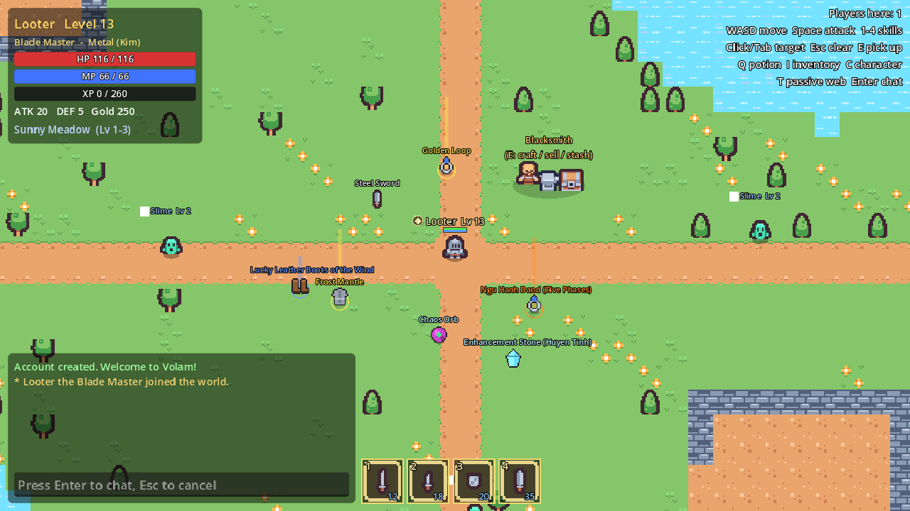 | 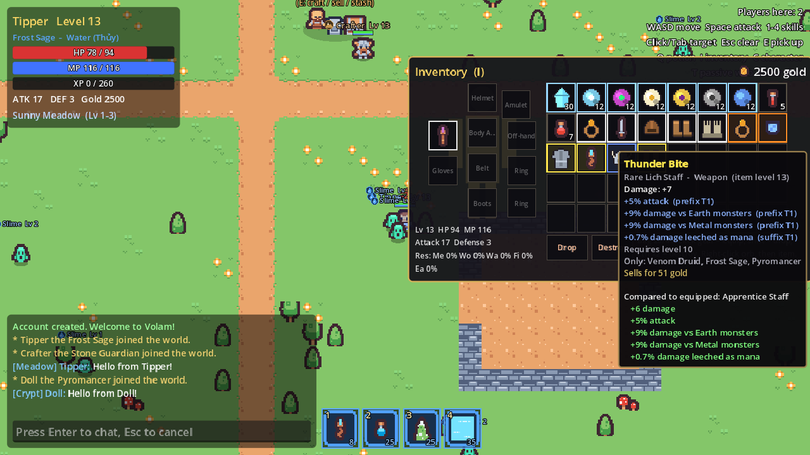 |
| **Paper-doll inventory** | **Blacksmith: crafting / enhancement / vendor / stash** |
| 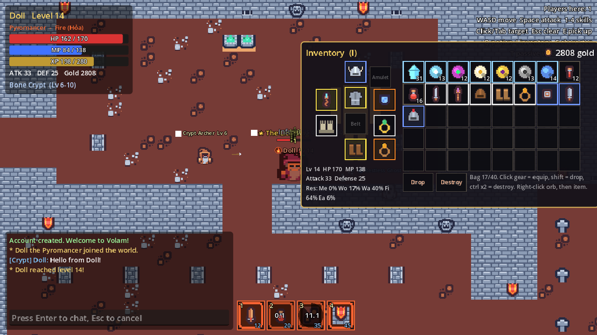 | 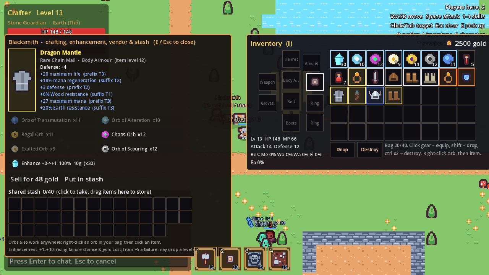 |

## Zones

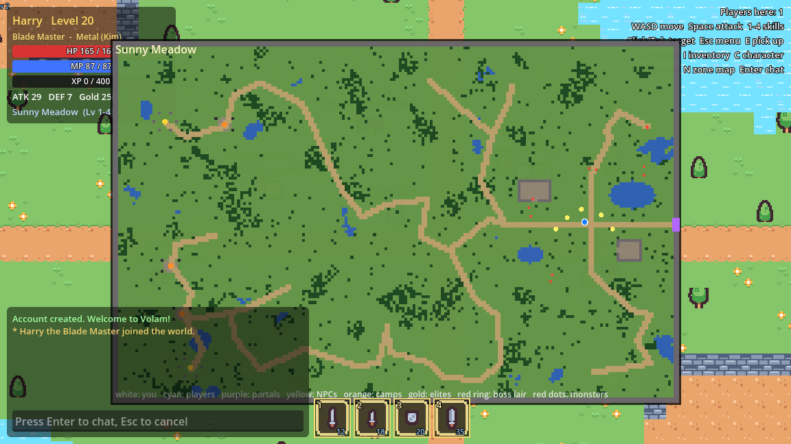

| Monster camp (camp fire, leader + mixed members) | Minimap while exploring |
|---|---|
| 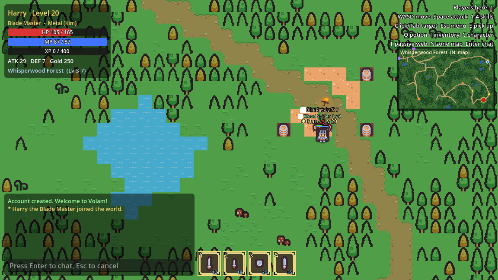 | 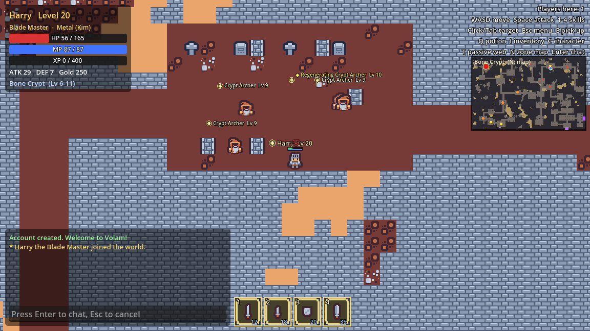 |

Every overworld zone is **200×128 tiles** (6400×4096 px). The old 64×40 maps were 2560 tiles, the new ones
25,600, so each zone has **10× the area** (3.1× wider, 3.2× taller).

| Zone | Levels | Entrance area (the old map) | The new wilds | Boss |
|---|---|---|---|---|
| Sunny Meadow | 1-4 | the town (all NPCs) on the east side, gate to the forest on the east edge | groves, ponds, stone ruins and roads to the west, north and south | - |
| Whisperwood Forest | 3-7 | north-west corner (gates to the meadow and the crypt) | dense woods with clearings and ponds to the east and south | Broodmother, lair in the far south-east |
| Bone Crypt | 6-11 | south-east corner (gates to the forest and Frostpeak) | catacomb halls, 3-wide corridors and sandy caverns to the north and west | The Lich King, lair in the far north-west |
| Frostpeak Ruins | 9-13 | west side (gate to the crypt) | pine forests, frozen lakes and rocks to the north, east and south | Yeti King, walled fortress in the far north-east |

**How a big map is built** (`scripts/zone_map.gd`, `_gen_overworld`, all from the zone's fixed seed):
1. themed outer terrain from two `FastNoiseLite` layers (tree groves / dense woods / pine forests, lakes, crypt caverns);
2. the original 64×40 layout is painted into the zone's **core** (the entrance area), so the town and every
   old landmark is still there, just moved by the core offset (`Zones.DB[zone]["core"]`);
3. about 25 **monster sites** are spread over the rest of the map (at least 15 tiles apart, away from the
   portals and the core) and carved as clearings, camps (trampled ground, barrels, a camp fire), elite stone
   circles or crypt halls, plus a walled **boss lair** with four gates;
4. roads (crypt: corridors) join every site to the nearest already-connected point, starting from anchors in
   the core, so everything is reachable; a solid border closes the map. The server checks at start-up that
   every portal, NPC, site and lair is reachable and logs `UNREACHABLE` otherwise.

### Monster groups

Monsters are spawned as **groups** (`Zones.DB[zone]["groups"]`, spawned by `zone.gd`):

| Group type | What it is | Where |
|---|---|---|
| `pack` | 2-6 of one type: slime clutches, Dire Rat (wolf-style) packs, bat swarms, spider nests, ghost hosts, yeti packs, ogre pairs | the entrance area ("core" groups, so new players always find something) and everywhere else |
| `camp` | a **leader** (+2 levels: Meadow Bandit, Wood Spider, Grave Crawler, Ice Ogre) with mixed members around a camp fire, e.g. bandit archers + boars, crawler + crypt archers + ghosts, ogre + yetis + frost bats | middle to far sites (depth 0.4-1.0) |
| `elite` | an **elite** (Hasted / Armoured / Brutal / Regenerating, ×2.5 life, +1 level, +40% item quantity / +100% rarity on its drops) leading 2-3 minions inside a stone circle | the far sites (depth 0.6-1.0) |
| `patrol` | 3-4 monsters that walk a loop between their site and the two nearest sites | anywhere (depth 0.2-0.9) |
| `guard` | the boss's bodyguards, just inside the lair gate | the boss lair |

* **Difficulty rises away from the entrance**: a site's depth is its distance from the zone entrance divided by the
  farthest site; group level = zone min level + (max - min) × depth. Core groups are min level (+0/1).
* **Pull one, the group comes**: when any member gets a target, every idle member of its group takes the same target.
  The server logs `group aggro: <monster> pulled by <player> - N groupmates join (group #id kind of types)`.
* **Groups respawn together**: dead members stay down until the *whole* group is dead, then after 1.5× the leader's
  respawn time all members come back around their site (`group #id ... respawned at (x, y): N members`).
  Patrols restart their loop.
* Elements (Metal > Wood > Earth > Water > Fire > Metal) and level scaling work as before. Sunny Meadow got three new
  low-level types for variety (Kenney sprites, tinted): **Mossling** (Wood), **Hill Boar** (Fire, lunges) and
  **Meadow Bandit** (Metal, ranged).
* Monster counts: about 80 per zone (meadow 79, forest 84, crypt 78, frost 81 incl. bosses), about 320 in total,
  versus about 65 on the old maps. That's 5× the monsters for 10× the area, so the wilds aren't wall-to-wall.
* Private dungeon instances and hideouts are unchanged (still 64×40, same generator and spawning).

### Performance: interest management inside a zone

* **Activation radius (server CPU)**: an overworld monster only runs its AI when a player of its zone is within
  **1500 px** (re-checked every ~0.5 s), or while it has a target / walks home. Zones nobody is in cost almost
  nothing. Respawn timers keep running.
* **Sync radius (bandwidth)**: each overworld monster's `MultiplayerSynchronizer` has a second visibility filter, so
  it is only spawned on and replicated to peers whose player is within **1300 px** (more than a screen). Bosses stay
  visible zone-wide. Moving around spawns and despawns monsters on the client as they come into range.
* The server logs, every 10 s per occupied zone, e.g.
  `[forest] perf: 84 monsters, 9 awake (AI running), 12 monster syncs to 1 player(s) (14% of a full-zone sync)`.

### Client frame rate ("fps drops in Whisperwood")

What the client spent per-frame work on before this change, and why Whisperwood was the worst zone:
* the server replicated **every monster of the zone** to the client, and every monster animated (bob/squish,
  tint) and called `queue_redraw()` every physics frame, on screen or not. Whisperwood had the most monsters
  of any zone (24 + the Broodmother's spiderlings, vs 10 / 17 / 15), so it had the most per-frame work. With
  10× maps and no change this would have grown to about 80 monsters per zone;
* every portal / NPC / anvil visual of **every zone** animated and redrew every frame, because every peer builds
  every zone (and every open dungeon / hideout instance).

Fixes: the server-side sync radius above (a client typically gets 5-15 monsters instead of the whole zone);
monsters skip animation + redraw while off-screen (`VisibleOnScreenNotifier2D` in `monster.gd`, AI still runs on
the server); decor visuals stop processing while off-screen (`VisibleOnScreenEnabler2D`, `NetUtil.cull_offscreen`).
The ground and all decor are still one `TileMap` per zone (no per-tile nodes), so a 10× map adds no nodes.

Measure it with `tools/bench_zones.sh` (a rendering client under `xvfb-run`, `--bench=SECS` prints frame time,
node count, physics time, monsters received; `SRV_ARGS=--no-interest` turns the interest radius off for
comparison). Phase 11 of `run_local_test.sh` runs headless bench clients at the Whisperwood entrance and boss lair
and fails if frame time ≥ 16.7 ms, physics time ≥ 4 ms, nodes ≥ 1500 or monsters received ≥ 40. Note that Godot
4.2's draw-call monitors read 0 with the `gl_compatibility` renderer, so draw calls aren't measured.

### Minimap and zone map

The HUD has a minimap of the whole zone (top right) and **N** opens a big zone map. Both show you (white), other
players (cyan), portals (purple), town NPCs (yellow), camps (orange), elite circles (gold), the boss lair (red ring)
and the monsters you can see (red dots). The terrain is a 1-pixel-per-tile image of the zone's TileMap, so it
always matches the map size. The camera limits come from the map size too.

### Old saves

Characters saved before the big maps have no `map_v` in their save, so their position is in old 64×40 coordinates.
On login it's shifted by the zone's core offset, which puts them on the same spot of the same landmark (the log says
`old-map position ... shifted to ...`). Any saved position that isn't on a reachable tile (outside the map, inside a
wall, stuck in an unreachable pocket) is moved to the nearest reachable tile (`saved position ... relocated to ...`).
New saves store `"map_v": 2`.

## Classes & the five elements

At your **first login** (and once for accounts saved before classes existed) you pick one of five
classes on the class selection screen. It shows each class's role, a stat preview (level 1 → level 10)
and its skills. The class is saved with the character. Press **C** for the character sheet:
class, element, stats, skills and the element cycle.

| Class selection | Character sheet (C) |
|---|---|
| 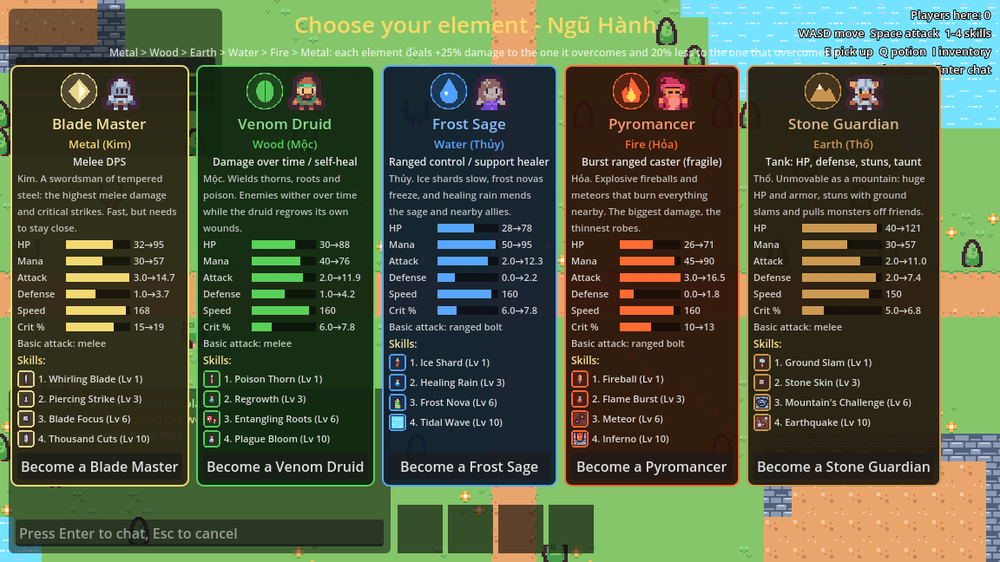 | 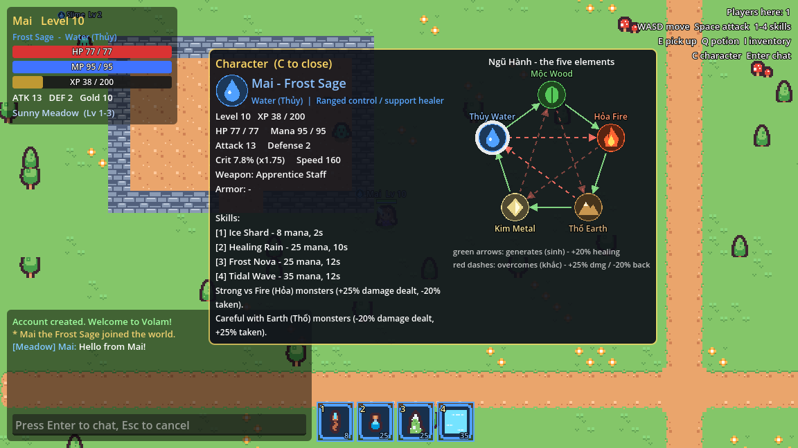 |

### Element chart (Ngũ Hành)

```
Overcoming (khắc), +25% damage:   Metal → Wood → Earth → Water → Fire → (back to Metal)
Generating (sinh), +20% healing:  Wood → Fire → Earth → Metal → Water → (back to Wood)

```
(The character sheet draws this as a proper pentagon + star, with your element highlighted.)

| Attacker → target | Multiplier |
|---|---|
| Attacker's element **overcomes** the target (Metal→Wood, Wood→Earth, Earth→Water, Water→Fire, Fire→Metal) | **×1.25** damage |
| Target's element overcomes the attacker (e.g. Wood hitting Metal) | **×0.80** damage |
| Anything else (same element, or generating pairs) | ×1.00 |
| Healing Rain on a target whose element the healer *generates* (Water → Wood) | +20% healing |

It works both ways: players hitting monsters **and** monsters hitting players. Every monster and
boss has an element, shown as a coloured icon in front of its name (the name is tinted too):

| Element | Monsters |
|---|---|
| Metal (Kim) | Crypt Archer, Frost Bat, **The Lich King** |
| Wood (Mộc) | Wood Spider, Spiderling, **Broodmother** |
| Water (Thủy) | Slime, Restless Ghost, Yeti, **Yeti King** |
| Fire (Hỏa) | Cave Bat, Grave Crawler |
| Earth (Thổ) | Dire Rat, Ice Ogre |

So Metal heroes shred the Broodmother, Fire burns through the Lich King, Earth tanks the Yeti
King's water... and Water mages should be careful around Ice Ogres.

### The classes

Stats grow every level: value = base + growth × (level − 1). Crits deal ×1.75 damage.
Mana regenerates 4% of max per second out of combat (2% in combat). Space is the basic attack:
melee for Metal/Wood/Earth, a short-range bolt (260 px, auto-aims at the nearest monster) for Water/Fire.

| | **Metal – Blade Master** (Kim) | **Wood – Venom Druid** (Mộc) | **Water – Frost Sage** (Thủy) | **Fire – Pyromancer** (Hỏa) | **Earth – Stone Guardian** (Thổ) |
|---|---|---|---|---|---|
| Role | melee DPS, crits | damage over time, self-heal | ranged control, group healer | burst AoE caster, fragile | tank: HP, armor, stuns, taunt |
| HP | 32 +7.0/lv | 30 +6.5/lv | 28 +5.5/lv | 26 +5.0/lv | **40 +9.0/lv** |
| Mana | 30 +3/lv | 40 +4/lv | **50 +5/lv** | 45 +5/lv | 30 +3/lv |
| Attack | 3 +1.3/lv | 2 +1.1/lv | 2 +1.15/lv | **3 +1.5/lv** | 2 +1.0/lv |
| Defense | 1 +0.3/lv | 1 +0.35/lv | 0 +0.25/lv | 0 +0.2/lv | **2 +0.6/lv** |
| Speed | **168** | 160 | 160 | 160 | 150 |
| Crit | **15%** +0.4%/lv | 6% +0.2%/lv | 6% +0.2%/lv | 10% +0.3%/lv | 5% +0.2%/lv |
| Basic attack | melee | melee | Frost Bolt | Fire Bolt | melee |
| Starting kit | Iron Sword | Apprentice Staff | Apprentice Staff | Apprentice Staff, +1 potion | Wooden Shield |

Skills (key, unlock level, mana, cooldown). Damage is a multiple of your attack, then the element
multiplier, then the target's defense:

| Key / Lv | Metal | Wood | Water | Fire | Earth |
|---|---|---|---|---|---|
| **1** / Lv 1 | **Whirling Blade** 12 mp, 4 s: 160% to all enemies within 72 px | **Poison Thorn** 10 mp, 3 s: thorn projectile 80% + **poison** 45%/s for 5 s | **Ice Shard** 8 mp, 2 s: projectile 140% + **slow** 40% for 3 s | **Fireball** 12 mp, 3 s: projectile that explodes (55 px) for 180% + **burn** 30%/s for 3 s | **Ground Slam** 12 mp, 6 s: 120% within 80 px + **stun** 1 s |
| **2** / Lv 3 | **Piercing Strike** 18 mp, 7 s: dash 130 px, 220% (always crits) to everything in the path | **Regrowth** 20 mp, 12 s: heal 10% max HP + 5%/s for 5 s | **Healing Rain** 25 mp, 10 s: heal self and **allies** within 150 px for 25% max HP | **Flame Burst** 20 mp, 8 s: 200% within 95 px + burn 40%/s for 4 s | **Stone Skin** 20 mp, 15 s: **shield** absorbing 30% max HP for 8 s |
| **3** / Lv 6 | **Blade Focus** 20 mp, 18 s: +40% crit chance, +25% attack for 6 s | **Entangling Roots** 25 mp, 12 s: at the nearest enemy, 60% within 90 px + root (stun) 1.5 s + poison | **Frost Nova** 25 mp, 12 s: 120% within 110 px + **freeze** (stun) 1.5 s | **Meteor** 35 mp, 14 s: telegraphed for 0.8 s, then 350% within 105 px + burn | **Mountain's Challenge** 15 mp, 12 s: **taunts** every monster within 230 px for 5 s, +50% defense |
| **4** / Lv 10 | **Thousand Cuts** 35 mp, 14 s: 5 quick hits × 90% on the nearest enemy | **Plague Bloom** 35 mp, 16 s: poison 80%/s for 6 s on every enemy within 130 px | **Tidal Wave** 35 mp, 12 s: wide piercing wave, 200% to everything in a line + slow 50% | **Inferno** 45 mp, 16 s: 12 fire bolts in a ring, 150% each | **Earthquake** 35 mp, 16 s: 3 tremors × 100% within 140 px + slow 50% |

Status effects: **poison** and **burn** tick every second and ignore defense; **slow** cuts movement
speed; **stun** (roots, freeze, slam) stops a monster from moving and attacking. Bosses take half
the slow and stun duration. **Shield** absorbs damage before HP. **Taunt** forces monsters to attack you.
Targeting is explained in [Mouse targeting](#mouse-targeting) below: skills use your selected target, then the
mouse cursor, then the nearest monster.

**Skill bar** (bottom of the HUD): icon per skill, hotkey number, mana cost (blue), a dark
**cooldown sweep** with the seconds left, a blue tint when you lack mana, and a "Lv N" lock until
unlocked. Hover for the description, click to cast.

**How the server stays the authority**: the client only sends "use skill N". The server checks the unlock
level, cooldown and mana, finds targets, does all hit detection (areas, dashes, projectiles), rolls
crits, applies element multipliers and status effects, and then tells the caster's client the cooldown.
Everyone in the zone gets an unreliable "effect" RPC so they can draw the rings, bursts, roots, slashes,
rain and meteor telegraphs in the caster's element colour.

**Class-restricted weapons**: heavy weapons (War Axe, Great Hammer, Frostbrand) are Metal/Earth only,
staves (Apprentice/Lich/Ember Staff) are Wood/Water/Fire only, and the Venom Dagger is Metal/Wood only.
Swords and shields fit everyone. Items your class can't use show up red in the inventory, and the server refuses to equip them.
Bosses drop gear for both groups (e.g. the Yeti King drops Frostbrand **and** the Ember Staff). Old
saves that had a now-forbidden weapon equipped get it moved back into the bag.

## Mouse targeting

* **Left-click** a monster to select it (an animated ring in its element colour appears under it, and a
  **target frame** at the top of the HUD shows its name, level, element, HP bar and active status effects:
  poisoned / burning / slowed / stunned / taunted). Left-click another player to select them as the target for
  ally heals (Healing Rain centres on them). **Right-click** selects a monster and attacks it straight away.
* **Tab** cycles through the nearest monsters, clicking empty ground clears the target.
* **Basic attacks and skills** use the selected target if it's valid and in range. If not, they fall back to
  the nearest monster, which is the old behaviour.
* **Directional skills** (Ice Shard, Fireball, Tidal Wave, Piercing Strike dash, Water/Fire basic bolts) fly toward
  the **mouse cursor** when no target is selected.
* **Ground skills** (Meteor, Entangling Roots) land **at the cursor**, clamped to their max range. While you hold
  the key or hover its skill-bar slot, a preview shows the range circle and the impact area. Release the key to cast.
  Area skills around you (Whirling Blade, Frost Nova, Earthquake...) show their radius.
* The client only sends `{target id, kind, cursor position}`. The **server** checks that the target exists, is in
  the caster's zone, is in range and (for ranged attacks) is in line of sight: trees and walls block, water doesn't.
  It also clamps the cursor to the skill's range. Rejected targets are logged (`target rejected: ... out of range`)
  and the skill falls back to the nearest valid target.

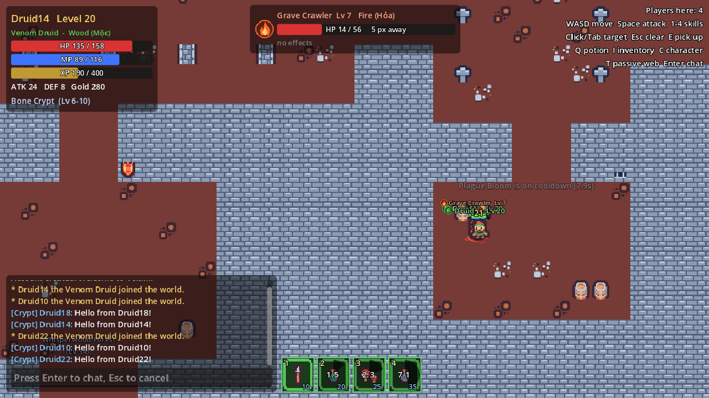
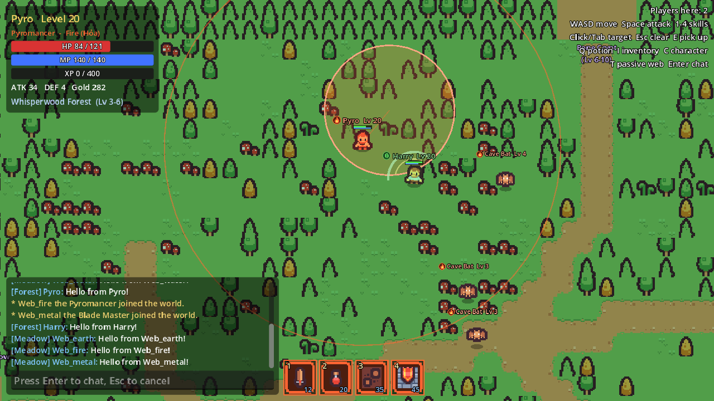

## Passive web (shared, Path of Exile style)

Press **T** to open the **passive web**. It's one big graph of **175 nodes** that **every class shares**:

* **Start nodes on the five-element pentagon.** The five class starts sit on the corners of a pentagon, in
  generating order (Wood → Fire → Earth → Metal → Water → Wood, clockwise from the top). Your own start
  is allocated for free and gives a small class bonus.
* **Adjacency rule.** You can only allocate a node that's linked to one you already own, so your allocation
  is always one connected web grown out of your start. The panel highlights allocatable nodes with a pulsing green ring.
* **Node types.** There are **small** nodes (110: minor stats), **notables** (45: named, bigger bonuses or class
  skill modifiers) and **keystones** (15, drawn as octagons: build-defining). The keystones are the 10 **class
  keystones**, 10 points out from each start, plus 5 **centre keystones** with real trade-offs. The other classes'
  starts are ordinary 1-point nodes, so you can path through them into another element's region.
* **Layout.** Two **class clusters** (the class's specialisations) fan outward from each start. The **pentagon edges**
  are "Wanderer's Path" rings with a farming notable halfway between neighbouring elements. Each start also has a
  **spoke** leading inward ("<Element> Ward" nodes and "Bane of <Element>", giving damage against the element that
  overcomes you) to the **hub ring** at the centre, where the centre keystones sit.
* **Points.** You get **1 point per level from level 2** (points = level - 1), so existing characters get theirs
  retroactively when they log in.
* **Refunds.** **Right-click an allocated node twice** to refund it for **5 + 2 × level gold**. This only works if
  everything else stays connected: a node in the middle of a path can't be refunded until the nodes beyond it are.
  **Reset web** (click twice) refunds everything for **20 + 10 × level gold**.
* **Server-authoritative.** The server checks every allocation (node exists, not already owned, points left,
  adjacent) and every refund (allocated, keeps the web connected, enough gold), and applies the effects in combat.
  Allocations are saved with the account. Saves that don't fit the current web (for example from the earlier
  per-class talent trees) are refunded automatically on login.
* **Panel.** Drag to pan, use the wheel to zoom, Space/Home to recentre. Hovering a node shows its name, type, region,
  effects and why it can or can't be allocated or refunded. The header shows points available/spent, the refund
  cost, your gold and the reset button. The character sheet lists your notables/keystones and a "Bonuses" line with your totals.

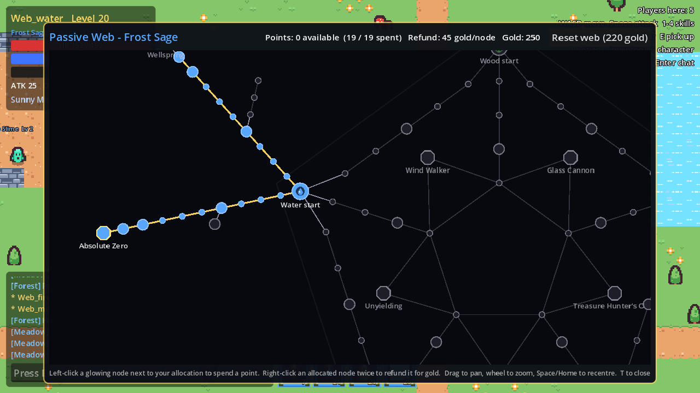

Screenshots for every class: `docs/screenshot_web_metal.png`, `_wood`, `_water`, `_fire`, `_earth` (each is a level-20 bot
that pathed to a class keystone).

### Centre keystones (trade-offs)

| Keystone | Effect |
|---|---|
| Glass Cannon | +30% attack, -25% max life |
| Treasure Hunter's Oath | +30% item quantity, +30% item rarity, +40% gold found, -20% attack |
| Blood Pact | 5% of damage dealt leeched as life, -50% mana regeneration |
| Unyielding | 20% less damage taken, -15% movement speed, -15% attack speed |
| Wind Walker | +20% movement speed, +15% attack speed, +15% cast speed, -15% max life |

### Pentagon-edge notables (farming)

| Between | Notable | Effect |
|---|---|---|
| Wood-Fire | Kindled Harvest | +10% item quantity, +5% gold found |
| Fire-Earth | Ash and Ore | +15% gold found, +6% item rarity |
| Earth-Metal | Forgeborn | +8% attack speed, +4% attack |
| Metal-Water | Quicksilver | +8% cast speed, +5% movement speed |
| Water-Wood | Life Spring | 2% life leech, +10% mana regeneration |

Ring small nodes give +2% attack, +4% item rarity, +3% life or +5% gold. Ward nodes give +6% and Bane notables +15%
damage vs your counter element (Bane also gives +5% rarity). Hub nodes give +2% life and mana.

### Class clusters

In each cluster, the main path from the start is a chain of small nodes, then a notable, another chain, a notable,
a tier-3 notable and the class keystone, which is **exactly 10 points away**. A side path branches off the first
notable with the remaining small chain/notable (often a farming or leech node). Skill modifiers only do something
for the class that owns the skill. Another class can path through them, but it gains nothing from them.

#### Metal (Kim)  (start node: +2% crit)


**Swordsman cluster**: Sustained melee and the whirling blade.

| Node(s) | Kind | Effect |
|---|---|---|
| Honed Edge | 3 small nodes (I-III), each | +4% attack |
| Steel Body | 3 small nodes (I-III), each | +5% max HP |
| Cyclone | notable | Whirling Blade: +45% damage, +24% radius |
| Battle Rhythm | notable | Basic attack hits restore 4 mana |
| Bloodthirst | notable | 3% of damage dealt is leeched as life |
| Relentless | notable | Whirling Blade cooldown -40% |
| Blade Storm | **class keystone** | Whirling Blade spins a second time 0.3 s later for 60% damage |

**Assassin cluster**: Critical strikes, mobility and executions.

| Node(s) | Kind | Effect |
|---|---|---|
| Keen Eye | 3 small nodes (I-III), each | +3% critical chance |
| Fleet Foot | 3 small nodes (I-III), each | +4% movement speed |
| Plunderer | 3 small nodes (I-III), each | +10% gold found, +6% item rarity |
| Lethal Precision | notable | +45% critical damage |
| Shadowstep | notable | Piercing Strike: cooldown -30%, dash range +40% |
| Focused Mind | notable | Blade Focus lasts +4 s |
| Death Mark | **class keystone** | Thousand Cuts strikes 3 more times, and ALL your hits on enemies below 30% HP deal double damage |

#### Wood (Mộc)  (start node: +3% life, +5% poison damage)


**Toxin cluster**: Deadlier, longer, spreading poison.

| Node(s) | Kind | Effect |
|---|---|---|
| Virulence | 3 small nodes (I-III), each | Poison deals +10% damage |
| Toxic Mind | 3 small nodes (I-III), each | +5% max mana |
| Barbed Thorn | notable | Poison Thorn deals +45% damage |
| Lingering Venom | notable | Your poisons last +3 s |
| Blight the Blade | notable | +24% damage vs Metal monsters (your counter element) |
| Spreading Bloom | notable | Plague Bloom: +30% radius, cooldown -20% |
| Pandemic | **class keystone** | when a poisoned enemy dies, its poison jumps to every enemy within 100 px |

**Grove cluster**: Bark, roots and regrowth: the druid who never falls.

| Node(s) | Kind | Effect |
|---|---|---|
| Bark Skin | 3 small nodes (I-III), each | +1 defense, +4% max HP |
| Sap Flow | 3 small nodes (I-III), each | +10% mana regeneration |
| Forager | 3 small nodes (I-III), each | +5% item quantity, +5% gold found |
| Deep Roots | notable | Entangling Roots: +0.9 s root, +30% radius |
| Verdant Growth | notable | Regrowth heals +50% |
| Lifebloom | notable | Regrowth cooldown -30% |
| Heart of the Forest | **class keystone** | Regrowth also heals allies within 150 px, and while it is active you take 20% less damage |

#### Water (Thủy)  (start node: +5% mana)


**Frost cluster**: Slows, freezes and shatters.

| Node(s) | Kind | Effect |
|---|---|---|
| Biting Cold | 3 small nodes (I-III), each | Ice Shard deals +12% damage |
| Glacial Mind | 3 small nodes (I-III), each | +5% max mana |
| Permafrost | notable | Your slows are 24% stronger and last +1.5 s |
| Deep Freeze | notable | Frost Nova: +0.8 s freeze, +20% radius |
| Frost Siphon | notable | 3% of damage dealt is leeched as mana |
| Shatter | notable | +40% damage to slowed or frozen enemies |
| Absolute Zero | **class keystone** | Ice Shard pierces through every enemy in its path and its cooldown is halved |

**Tide cluster**: Healing, protection and crashing waves.

| Node(s) | Kind | Effect |
|---|---|---|
| Flowing Grace | 3 small nodes (I-III), each | Your healing is +10% stronger |
| Tidal Body | 3 small nodes (I-III), each | +5% max HP |
| Tidecaller's Luck | 3 small nodes (I-III), each | +8% item rarity |
| Spring Rain | notable | Healing Rain: +30% radius, cooldown -24% |
| Undertow | notable | Tidal Wave deals +40% damage |
| Clarity | notable | All skills cost 16% less mana |
| Wellspring | **class keystone** | Healing Rain also shields everyone it heals for 15% of their max HP (6 s) and restores 10% of their mana |

#### Fire (Hỏa)  (start node: +3% attack)


**Inferno cluster**: Bigger fires, more fires, everywhere.

| Node(s) | Kind | Effect |
|---|---|---|
| Kindling | 3 small nodes (I-III), each | +4% attack |
| Wildfire | 3 small nodes (I-III), each | Burns deal +12% damage |
| Conflagration | notable | Flame Burst: +36% radius, +30% damage |
| Firestorm | notable | Inferno fires 4 more bolts |
| Quickening Flames | notable | +12% cast speed (all skill cooldowns recover faster) |
| Cataclysm | notable | Meteor: +30% radius, cooldown -20% |
| Meteor Shower | **class keystone** | each Meteor is followed by 2 smaller meteors (60% damage) on other enemies nearby |

**Ember cluster**: Single-target burst and a fire that refuses to die.

| Node(s) | Kind | Effect |
|---|---|---|
| Ember Focus | 3 small nodes (I-III), each | +3% critical chance |
| Mana Font | 3 small nodes (I-III), each | +5% max mana |
| Ember Greed | 3 small nodes (I-III), each | +12% gold found |
| Pyroblast | notable | Fireball deals +45% damage |
| Ignition | notable | Fireball cooldown -30% |
| Combustion | notable | +50% critical damage |
| Phoenix Heart | **class keystone** | once every 60 s, a killing blow instead leaves you at 30% HP and you explode in a Flame Burst |

#### Earth (Thổ)  (start node: +2 defense)


**Bulwark cluster**: The wall that the party hides behind.

| Node(s) | Kind | Effect |
|---|---|---|
| Granite | 3 small nodes (I-III), each | +2 defense |
| Mountain Heart | 3 small nodes (I-III), each | +6% max HP |
| Prospector | 3 small nodes (I-III), each | +5% item quantity, +4% item rarity |
| Reinforced Stone | notable | Stone Skin absorbs +45% more |
| Stand Firm | notable | Mountain's Challenge: cooldown -30%, radius +20% |
| Thorns of Stone | notable | Reflect 30% of melee damage taken back at the attacker |
| Unbreakable | **class keystone** | take 15% less damage; when Stone Skin breaks or ends it erupts, stunning enemies within 110 px for 1.5 s |

**Quake cluster**: Shake the ground until nothing stands.

| Node(s) | Kind | Effect |
|---|---|---|
| Heavy Hands | 3 small nodes (I-III), each | +5% attack |
| Tremor | 3 small nodes (I-III), each | Ground Slam deals +12% damage |
| Seismic Reach | notable | Ground Slam +24% and Earthquake +24% radius |
| Concussion | notable | Ground Slam stuns +0.6 s longer |
| Rhythm of Stone | notable | +16% attack speed, +20% damage vs Wood monsters (your counter element) |
| Rolling Thunder | notable | Earthquake has 2 more tremors |
| Tectonic Fury | **class keystone** | every Earthquake tremor stuns for 0.6 s, and Ground Slam's cooldown is halved |

### The stat system (and how gear affixes plug in)

All bonuses go through **`scripts/stats.gd`**. A bonus source is just a dictionary of generic stat keys
(`atk_pct`, `hp_pct`, `crit`, `crit_dmg`, `speed_pct`, `item_rarity`, `item_quantity`, `gold_find`, `life_leech`,
`mana_leech`, `attack_speed`, `cast_speed`, `dmg_vs:<element>`, `dmg:<skill>`, `cd:<skill>`, ...).
`Stats.gather(class, passives, equipment)` adds up **allocated passive-web nodes + the `mods` of every equipped item** into one dictionary
(`player.tmods`). Combat, loot and the UI read only that dictionary: `player.tm("gold_find")`, `Talents.skill_def_m(...)`
for skills, and `zone.drop_loot()` for the killer's quantity/rarity/gold find.
Gear plugs in exactly like that: `Stats.gather` reads `Gear.mods(instance)` (implicit + rolled affixes + upgrade bonus)
for every equipped item, next to the passive web. The same stat keys are used by both, so an affix of "+10% item rarity" and a passive
node of "+10% item rarity" stack. New keys for gear: `life_flat`, `mana_flat`, `dmg_flat`, `def_flat`, `ele_dmg_pct`,
`res:<element>`, `res_all`, `mp_regen_pct`, `dot_poison`, `dot_burn`.

## Gear, loot & crafting

The loot loop is Path of Exile mixed with Vo Lam Truyen Ky: farm monsters, pick up gear and currency, then use orbs
and enhancement stones on the gear at the blacksmith. **All randomness runs on the server**: the client only asks
("use this orb on item #uid"). The server checks that you own both, that the orb applies, and that you're at the
blacksmith (where that's needed), then rolls the result and sends you your updated inventory.

### Equipment slots and item instances

Slots: **weapon, off-hand (shield), helmet, body armour, gloves, boots, belt, amulet, ring ×2**.
Every piece of gear is an instance:

```
{uid, base: "chain_mail", rarity: "rare", ilvl: 12, upg: 3, name: "Frost Shell",
 mods: [[affix_id, stat, value, tier, "p"/"s"], ...], uniq: "<unique id, uniques only>"}
```

`Gear.mods(inst)` returns *implicit + affixes + upgrade bonus*, and `Stats.gather` adds that up for every equipped item,
along with the passive web.

| Slot | Bases (required level) | Class restriction |
|---|---|---|
| Weapon | Iron Sword (1), Apprentice Staff (1), Steel Sword (4), War Axe (6), Great Hammer (10), Lich Staff (10); boss-only Venom Dagger (6), Frostbrand (13), Ember Staff (13) | staves: Wood/Water/Fire, axe/hammer/Frostbrand: Metal/Earth, dagger: Metal/Wood |
| Off-hand | Wooden Shield (1), Iron Shield (4), Bone Shield (8), Frost Aegis (13, boss) | - |
| Helmet | Leather Cap (1), Iron Helm (6), Horned Helm (11, +10 life) | - |
| Body | Cloth Robe (1, +10 mana), Leather Vest (3), Chain Mail (8), Plate Armour (12) | plate: Metal/Earth |
| Gloves | Cloth Wraps (1), Iron Gauntlets (7) | - |
| Boots | Sandals (1, +3% move), Leather Boots (5, +4% move), Iron Greaves (9) | - |
| Belt | Rope Belt (1, +5 life), Leather Belt (6, +12 life) | - |
| Amulet | Jade Amulet (1, +3% all res), Coral Amulet (7, +15 life) | - |
| Ring | Copper Ring (1, +5 mana), Jade Ring (5, +8% Wood res), Silver Ring (9, +1% crit) | - |

The **required level** is the base's level, raised to 80% of the item level of the highest affix tier it has.
Uniques use their own level. The server rejects equipping above your level or outside your class (the tooltip shows
this in red).

### Rarity

| Rarity | Colour | Affixes | Base drop chance (× (1 + item rarity / 100)) |
|---|---|---|---|
| Normal | white | none (implicit only) | the rest |
| Magic | blue | 1-2 (max 1 prefix + 1 suffix) | 32% |
| Rare | yellow | 3-6 (max 3 prefixes + 3 suffixes), random two-word name (e.g. *Iron Song*, *Frost Shell*) | 9% |
| Unique | orange | fixed, hand-designed | 1.2% (world uniques for that item level) |

**Item level** is the monster's level (bosses +2). Affix tiers are gated by item level, so a level-3 slime can
only roll tier-1 affixes and Frostpeak monsters (level 9-12) roll the top tiers.

### Affix pools (generic stat keys, same as the passive web)

| Prefixes | Tiers (min item level: value range) |
|---|---|
| + maximum life (`life_flat`) | 1: 5-10, 5: 11-18, 10: 19-28, 14: 29-40 |
| + maximum mana (`mana_flat`) | 1: 5-10, 6: 11-20, 12: 21-32 |
| + flat damage (`dmg_flat`) | 1: 1-2, 5: 3-4, 9: 5-7, 13: 8-10 |
| % attack (`atk_pct`) | 1: 5-9, 6: 10-16, 11: 17-25 |
| % elemental (skill) damage (`ele_dmg_pct`) | 1: 6-10, 7: 11-18, 12: 19-28 |
| + defense (`def_flat`) | 1: 1-2, 6: 3-4, 11: 5-7 |
| % damage vs <element> monsters (`dmg_vs:<el>`, ×5) | 1: 6-10, 8: 11-18, 13: 19-26 |
| % item rarity (`item_rarity`) | 1: 4-8, 6: 9-14, 12: 15-22 |
| % <skill> damage (`dmg:<skill>`, rolls a skill of the looter's class) | 3: 10-16, 9: 17-26, 14: 27-36 |

| Suffixes | Tiers |
|---|---|
| % <element> resistance (`res:<el>`, ×5) | 1: 6-11, 5: 12-17, 10: 18-24, 14: 25-30 |
| % all resistances (`res_all`) | 8: 3-5, 13: 6-9 |
| % attack speed / % cast speed | 1: 3-5, 7: 6-9, 12: 10-13 |
| % crit chance / % crit damage | 1: 1-2 … 11: 3-5 / 5: 8-14, 11: 15-24 |
| % life leech / % mana leech | 4: 0.4-0.8, 10: 0.9-1.5 |
| % movement speed (boots only) | 1: 4-7, 6: 8-11, 11: 12-16 |
| % item quantity / % gold find | 5: 3-5, 11: 6-9 / 1: 5-10 … 11: 19-28 |
| % mana regeneration | 1: 8-14, 7: 15-24 |

Each affix can only roll on sensible slots (movement speed only on boots, leech on weapons/rings/gloves, and so on),
and each one is weighted.

### Uniques

| Unique | Base | Lvl | Effects | Source |
|---|---|---|---|---|
| Venom Dagger | Venom Dagger | 6 | +10% attack speed, +25% poison damage, +15% dmg vs Earth | **Broodmother** |
| Soulbinder | Lich Staff | 10 | 1.5% mana leech, +30 mana, +10% cast speed, −10% Metal res | **Lich King** |
| Frostbrand | Frostbrand | 13 | +20% dmg vs Fire, +25% Water res, +8% attack speed | **Yeti King** |
| Ember Staff | Ember Staff | 13 | +12% cast speed, +30% burn damage, +20% elemental dmg, −15% Water res | **Yeti King** |
| Frost Aegis | Frost Aegis | 13 | +20% Fire res, +30% Water res, +30 life | **Yeti King** |
| Ngu Hanh Band (Five Phases) | Silver Ring | 9 | +12% all res, +10% elemental damage | world |
| Kim Long (Golden Dragon) Amulet | Jade Amulet | 5 | +20% dmg vs Wood, +4% crit, +30% gold find | world |
| Moc Diep (Thousand-Leaf) Treads | Leather Boots | 5 | +18% move speed, +20% Metal res, +15% item rarity | world |
| Thuy Tam (River Heart) Circlet | Iron Helm | 6 | +40 mana, +30% mana regen, +25% Fire res | world |
| Hoa Quyen (Emberfist) | Iron Gauntlets | 7 | +6 flat damage, +20% burn, +8% attack speed, −10% Water res | world |
| Tho Son (Mountain-Root) Girdle | Leather Belt | 6 | +60 life, +4 defense, +20% Wood res, −5% move speed | world |
| Gold Seeker's Ring | Copper Ring | 3 | +12% item quantity, +25% item rarity, +40% gold find, −10% attack | world |

The boss uniques are guaranteed drops. World uniques drop anywhere their level allows when the rarity roll lands on Unique.

### Drops, item quantity and item rarity

Every kill drops gold plus rolls on the monster's table: potions, `@gear` (random base for the item level) and
`@currency` (9% per kill). Bosses always drop 3 currency, their uniques, 3+ magic items (plus a rare from the Lich King
and Yeti King) and potions.

* **Item quantity (IIQ)** = killer's `item_quantity` + the monster's own bonus. It multiplies the gear and currency
  roll counts by (1 + IIQ/100).
* **Item rarity (IIR)** = killer's `item_rarity` + the monster's bonus. It multiplies the Magic/Rare/Unique chances by (1 + IIR/100).
* Monster bonuses: Grave Crawler +15% IIR, Ice Ogre +20% IIQ / +30% IIR, Broodmother and Lich King +50% / +150%,
  Yeti King +60% / +200%.
* `--debug-loot` multiplies regular monsters' drop chances for testing. `--loot-showcase` (server) drops one item of each rarity in the meadow for screenshots.

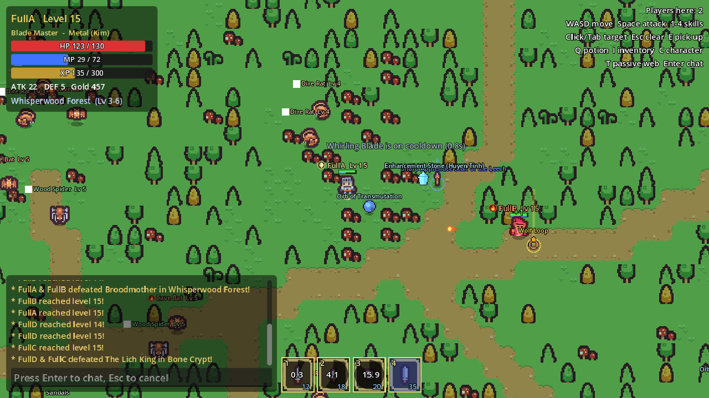

On the ground, every item shows its name in its rarity colour. Magic/rare/unique items get a light beam,
and rares/uniques flash and play a chime when they drop. Gear that would overflow a full bag stays on the ground
(the server says "bag full").

### Elemental resistances

Players have a resistance to each of the five elements (`res:metal` … `res:earth`, plus `res_all`), **capped at 75%**
(negative values from uniques make you take more). Incoming damage from a monster of that element is
`damage × element-cycle multiplier × (1 − resistance)`, then armour and other reductions apply. The character sheet (C) and
the inventory show all five.

### Currency (stacks in the bag)

| Currency | Effect | Invalid use (rejected by the server) |
|---|---|---|
| Orb of Transmutation | Normal → Magic (1-2 affixes) | not Normal |
| Orb of Alteration | rerolls a Magic item's affixes | not Magic |
| Regal Orb | Magic → Rare, adds an affix (a Rare always ends with ≥ 3) | not Magic |
| Chaos Orb | rerolls a Rare with 3-6 new affixes (new name) | not Rare |
| Exalted Orb | adds one affix to a Rare | not Rare, or already 6 affixes |
| Orb of Scouring | removes all affixes → Normal (keeps the +N upgrade) | already Normal |
| Enhancement Stone (Huyền Tinh) | +1 upgrade level (see below) | not at the blacksmith, at +10, not enough gold |

None of the orbs work on Uniques. Orbs work anywhere: right-click the orb in your bag, then click an item (equipped
items work too). Or use the blacksmith panel.

### Enhancement (+1 … +10, Vo Lam style)

At the blacksmith, one Enhancement Stone + gold tries to raise an item by one level:

| Attempt | +0→1 | +1→2 | +2→3 | +3→4 | +4→5 | +5→6 | +6→7 | +7→8 | +8→9 | +9→10 |
|---|---|---|---|---|---|---|---|---|---|---|
| Success | 100% | 90% | 80% | 70% | 60% | 50% | 40% | 30% | 20% | 10% |
| Gold | 10 | 40 | 90 | 160 | 250 | 360 | 490 | 640 | 810 | 1000 |

* A failure below +5 does nothing (the stone and the gold are used up).
* A failure from **+5 or higher** has a 50% chance to **drop one level**.
* **An item is never destroyed.**
* Each level gives weapons +1 damage + 10% of base damage, armour +½ defense (rounded up), and
  jewellery/belts +3 life.

### The blacksmith (Sunny Meadow)

An anvil and a chest stand just north-east of the meadow spawn. Walk up to it and press **E**. The panel lets you:

* select an item (click it in the bag/paper doll or drag it in), apply any orb you own, or enhance it (it shows the
  chance and the gold cost);
* **sell** the selected item for gold (Normal 2+ilvl, Magic 5+2·ilvl, Rare 12+3·ilvl, Unique 40+4·ilvl, +10 per
  upgrade level; Slime Gel sells for 1). Selling, enhancing and the stash only work within ~100 px of the anvil, and the
  server checks this;
* use the **shared stash** (40 gear slots): click a stash item to take it, or drag gear onto the stash. The stash is stored on the
  **account** (`accounts.json → accounts.<name>.stash`), not on the character, so a future multi-character system
  shares it automatically.

### Migration of old saves

Saves from before the gear update (plain item ids such as `"steel_sword"` in the inventory or equipment) are converted
at login: plain gear becomes Normal instances, old boss weapons become their Unique versions, and the old `armor` slot moves
to `offhand`. Stackables stay as stacks. The server log says `migrated N old item(s) to gear instances`, and the save is
then written in the new format (`items_v: 2`).

## Dungeons & the Atlas (endgame, Path of Exile style)

The endgame works like Path of Exile's maps. You **open Dungeon Tickets at the Map Device**
in Sunny Meadow. Each ticket opens a **private, procedurally generated dungeon instance**.

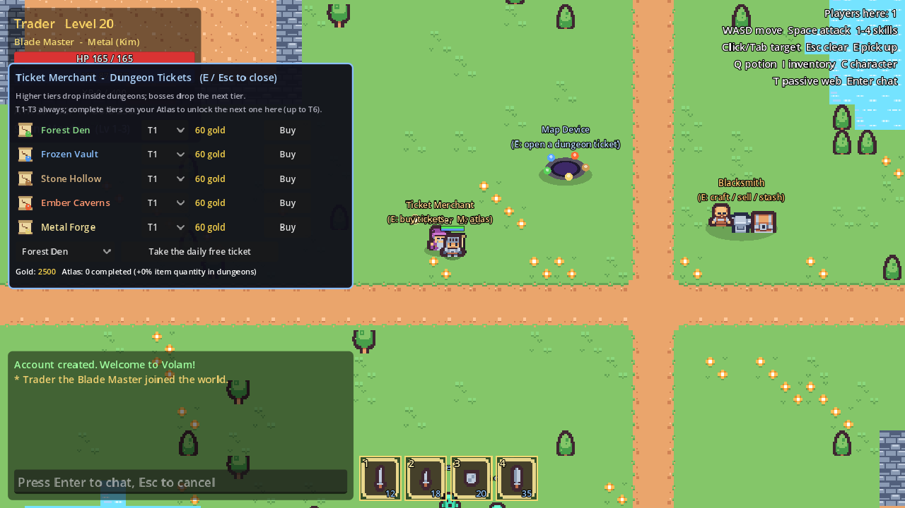
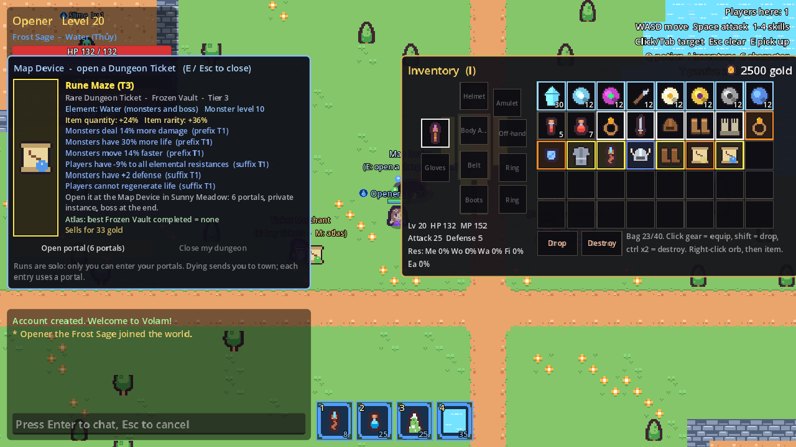

### Dungeon Tickets

* **Five themes, one per element:**

  | Ticket | Element | Layout | Boss |
  |---|---|---|---|
  | **Forest Den** | Wood | caves | Den Matriarch |
  | **Frozen Vault** | Water | rooms | Vault Warden |
  | **Stone Hollow** | Earth | rooms | Crypt Lord |
  | **Ember Caverns** | Fire | caves | Ember Tyrant |
  | **Metal Forge** | Metal | rooms | Forge Golem |

  All monsters in a dungeon (including the boss) take the theme's element, so the
  Ngũ Hành cycle matters. Pick a class that counters the element.
* **Tiers T1-T10.** Monster level is 4 + 2 × tier, and the ticket's item level is 2 × tier.
* **Rarity** works like gear: Normal, Magic (1-2 mods), Rare (3-4 mods) and Unique.
  * There is one unique ticket, *Sanctum of the Five Phases* (T8 Metal Forge). Its mods are fixed: +60% monster life, +30% extra elemental damage, +3 elite packs and -20% player resistances.
* **Map mods** are affixes with a special `ticket` slot, so every crafting orb works on tickets:
  * Transmute, Alteration, Regal, Chaos, Exalt and Scour all work as usual.
  * Enhancement stones don't work on tickets.
  * Prefixes: more monster life, more monster damage, extra elemental damage, bigger packs, more elite packs, faster monsters.
  * Suffixes: players have less resistance, no life regeneration or less mana regeneration; monsters gain defense.
* **Item quantity and rarity.** Every mod adds item quantity (IIQ) and item rarity (IIR) to the whole run.
  * By mod tier, a mod adds +4/6/9% IIQ and +6/10/15% IIR. Unique mods add +8% IIQ and +12% IIR.
  * The **Cartographer's Chisel** (new currency) adds +5 quality, up to 20. Each quality point adds +1% IIQ.
  * The tooltip shows the run's total IIQ and IIR. So do the Map Device panel and the HUD inside the dungeon.

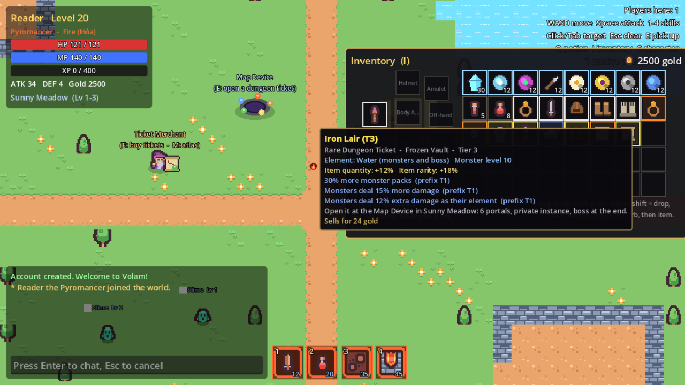

### Where tickets come from

* **The Ticket Merchant** stands next to the Map Device in Sunny Meadow (press E).
  * Price: 25 + 35 × tier² gold.
  * It sells tickets only for **unlocked Atlas nodes up to T5** (see the Atlas below). T7, the Guardians and the pinnacle only drop.
  * **One free ticket per day**: a Magic ticket of your highest unlocked merchant node, in the theme you choose.
* **Dungeon monsters** have a 3% chance to drop a ticket for the node you're in (elites: 15%). Atlas passives raise this.
* **Overworld monsters** of level 6 and up have a 1% chance to drop a T1 ticket.
* **Bosses** always drop a ticket. 65% of the time it's for an **adjacent Atlas node**. There's a 30% chance of a second ticket (more with the boss-loot atlas passives).

### The Map Device and portals

* Put a ticket in the device (press E, then click the ticket in your bag) and press **Open portal**.
  * The ticket is used up.
  * A portal labelled with the dungeon's name, the owner and the portals left appears above the device.
* **Each run has 6 portals.** Every entry uses one.
* **Dying inside a dungeon sends you back to town** (you respawn at full health). Going back in costs another portal.
* When all 6 portals are used and nobody is inside, the dungeon closes.
* **Solo only, for now.** Only the player who opened a dungeon can enter it. Other players see the portal but get "that portal belongs to …".
  * The check sits in one function (`Instances._may_enter`), so a party system only needs to widen that check later.
* Logging out inside a dungeon puts you back in Sunny Meadow when you log in.

### Inside a dungeon

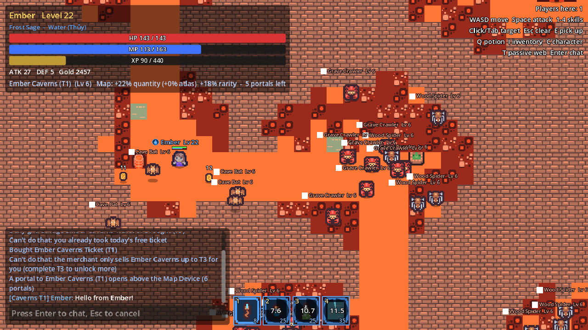
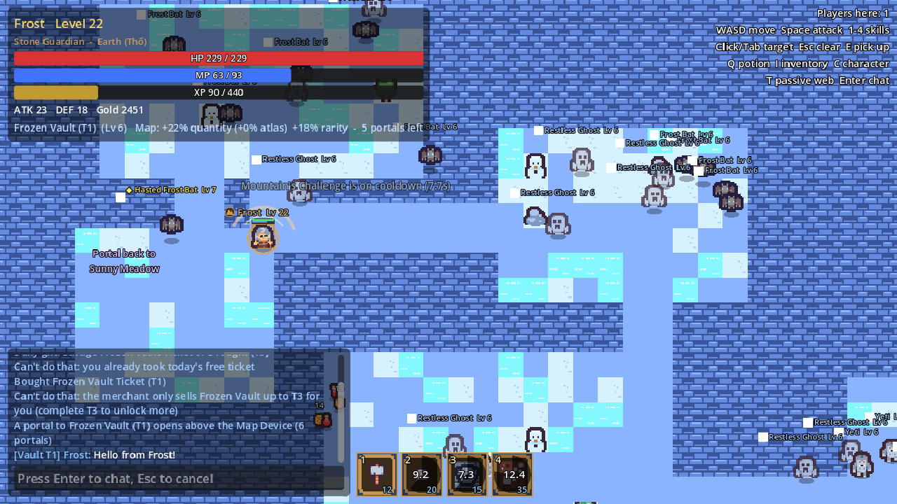

* **Map generation.** Each instance has its own seed, and the map is built from it.
  * Up to 10 rooms (round caves for the cave themes, rectangles for the rest).
  * L-shaped corridors chain the rooms from the entrance to the boss room, plus a few extra loops.
  * Tiles and tint follow the theme.
* **Monster packs** fill every room except the entrance. Pack count scales with room size and the "bigger packs" mod.
* **Elite packs** (1 + tier/4, plus the elite mod) have a gold ◆ name. They get ×2.5 life and ×1.3 damage, plus one modifier:
  * Hasted
  * Armoured
  * Brutal
  * Regenerating
  
  Elite kills get +40% IIQ and +100% IIR on their drops.
* **The boss** waits in the last room at monster level + 2. Killing it completes the run:
  * a "Dungeon Complete!" banner and a chat announcement
  * guaranteed boss loot (3 magic, 1 rare, potions) plus the ticket drops above
* After completion the instance closes **60 s** later. Anyone still inside is sent back to town.
* An **empty** instance closes after **90 s**.
* Instances use the same zone visibility system as the overworld. Clients only receive the entities of the instance they're in, and several instances run at once.

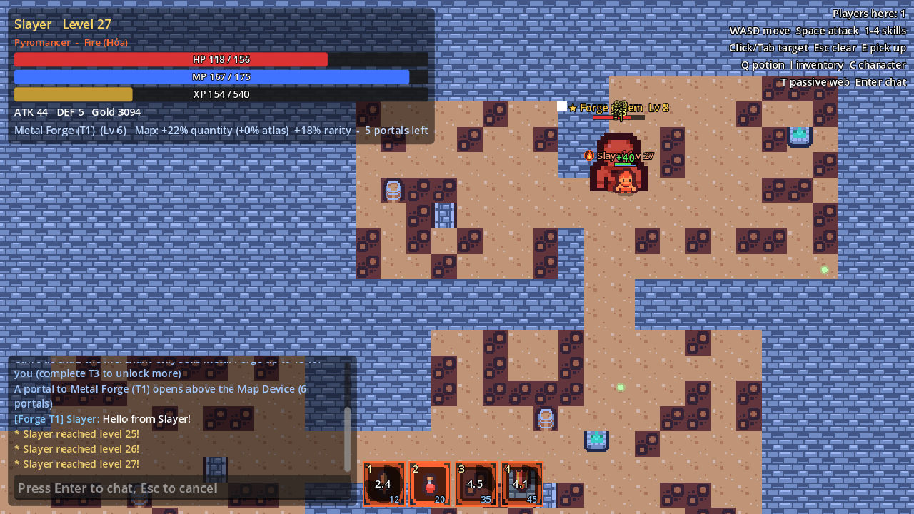

### Atlas (M) - Path of Exile style

| Atlas map | Node tooltip | Atlas passive tree |
|---|---|---|
| 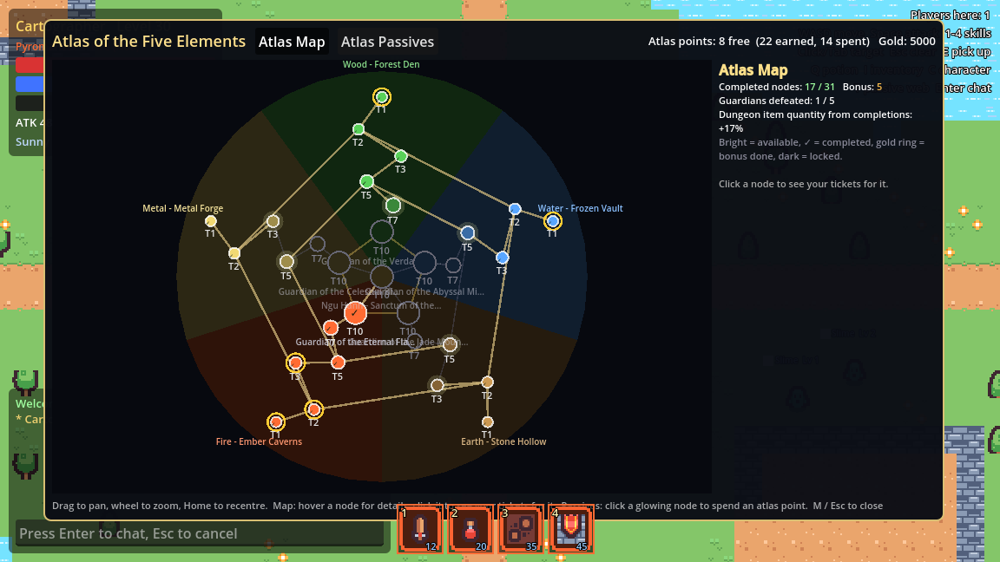 | 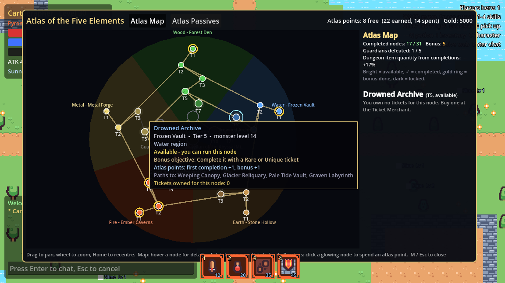 | 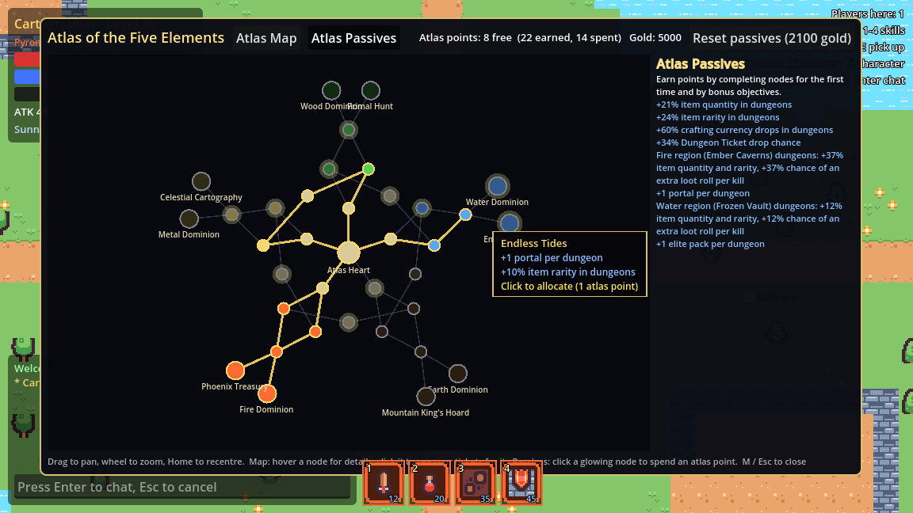 |

Press **M** anywhere (or look at the Ticket Merchant's "M: atlas" hint) to open the Atlas. It has two tabs.

**Atlas Map.** A pannable (drag) and zoomable (mouse wheel, Home recentres) world map of **31 named dungeon nodes**:

* **Five elemental regions** (Wood/Forest Den, Water/Frozen Vault, Earth/Stone Hollow, Fire/Ember Caverns, Metal/Metal Forge) are arranged around a **central pentagon**.
  Each region is a chain of six nodes, from the outer ring inwards: **T1 → T2 → T3 → T5 → T7 → Guardian (T10)**.
  Every node has its own name (for example *Cinder Throat*, *Sunken Treasury*, *Guardian of the Jade Mountain*) and a **fixed layout seed**, so a node always generates the same dungeon.
* **Paths.** Nodes connect along their region chain. Ring paths join neighbouring regions at T2 and T5. All five Guardians connect to the centre.
* **Unlocking.** The five T1 nodes are open from the start. A node becomes **available** once an **adjacent node has been completed**.
  **Ngu Hanh, Sanctum of the Five Elements** (the pinnacle, T10 at the centre) opens only after **all five Guardians** are defeated.
  Guardian bosses have ×2 life and the pinnacle boss ×3, both with stronger hits. The pinnacle drops **two guaranteed unique items**.
* **Visual states:** dark = locked, bright with a pulsing halo = available, full colour with ✓ = completed, gold outer ring = bonus objective completed, blue ring = selected.
* **Tooltip** (hover a node): name, theme, tier, monster level, region/Guardian/pinnacle, state and run count, bonus objective (and whether it's done), atlas points still on offer, connected nodes, and how many tickets you own for it.
* **Click a node** to list the tickets in your bag/stash that open it (or a hint that the merchant sells it).

**Tickets and nodes.**

* Every ticket belongs to a node. New tickets carry a `node` field. Old tickets without one map to their theme at the nearest region tier at or below their tier (for example an old T4 Frozen Vault ticket opens *Glacier Reliquary*, the T3 node).
* **You can only open a ticket whose node is unlocked.** The server rejects the rest ("atlas node … is locked").
  **Unique tickets** (Sanctum of the Five Phases) are not tied to a node, can be opened anywhere, and give no atlas progress.
* **Bosses favour adjacent nodes.** The boss's guaranteed ticket is for a random **adjacent** node 65% of the time (otherwise the same node). This gives you tickets to push outwards (the sustain loop).
* Dungeon monsters drop tickets for the node you are in. The *tier* atlas passives give a chance that a drop is for an adjacent higher-tier node instead.
* **The Ticket Merchant only sells unlocked nodes up to T5.** The daily free Magic ticket is for your highest unlocked merchant node in the chosen theme.

**Atlas points and bonus objectives.**

* **+1 point** for the **first completion** of each node.
* **+1 point** for its **bonus objective**, once per node. The objectives (by tier):
  * T1/T5: complete it with a **Rare or Unique** ticket.
  * T3/T7: **slay every elite pack** before the boss dies.
  * T2/Guardian/pinnacle: complete it **without dying**.
* That's 62 points in total.

**Atlas Passives.** A tree of **36 nodes** (Atlas Heart + 5 arms + an inner and an outer ring). Click a glowing node next to your allocation to spend a point. "Reset passives" (click twice) refunds everything for **150 gold per point**.

| Effect | Where |
|---|---|
| +item quantity / rarity in dungeons | inner ring, outer ring |
| +Dungeon Ticket drop chance | every arm ("Ticket Hoarder"), Dominion notables |
| +chance a dropped ticket is for a higher-tier adjacent node | Metal arm (Honed Compass, Celestial Cartography) |
| +elite packs per dungeon | Wood arm (Teeming Wilds, Primal Hunt) |
| +portals per dungeon (6 → 8 max) | Water arm (Tidal Gate, Endless Tides) |
| boss loot: extra boss loot rolls and an extra adjacent-node ticket | Earth arm (Tomb Raider, Mountain King's Hoard) |
| bonus crafting currency per kill | Fire arm (Ember Coin, Phoenix Treasury) |
| **region boost**: +X% quantity and rarity, and an X% chance of an extra loot roll per kill, **only in that element's dungeons** | "Attunement" / "Dominion" in each arm |

* Everything is decided **server-side**. The owner's passives are snapshotted when the ticket is opened (stored on the instance as `afx`).
* `zone.drop_loot` adds IIQ/IIR, ticket chance, tier-up, extra loot rolls and currency. `zone.spawn_dungeon` adds elites. `instances.open_run` adds portals, and the boss completion adds boss loot.
* The server log prints the effects on every open, and every drop that gained extra rolls.

**Persistence and migration.**

* The atlas is saved per account in the character save: `{"v": 2, "done": {node: runs}, "bonus": {node: true}, "passives": [...], "migrated": [...]}`.
* Old saves with the previous 5 × 10 grid migrate on login. Keys that are map nodes keep their id (`fire:3`). T4/T6/T8/T9 move to the region node below (T3/T5/T7/T7) and merge. Each migrated node counts as a first completion (points granted). The migration is logged.
* Saved passives are re-validated on load: unknown, unconnected or unpaid passives are dropped.
* The old "+1% item quantity per completed node (max +30%)" bonus is kept.

### How it's built

* `scripts/dungeons.gd` holds the data and the pure functions: themes, tiers, prices, map-mod IIQ/IIR, tooltips, atlas math, layout generation, and zone definitions.
* `scripts/instances.gd` is the server-side run manager.
  * It handles buying and the free ticket, opening a run, portals, entry rules, death, completion, the atlas update, timeouts and cleanup.
  * Through RPCs it makes every peer build or free the instance zone from the same seed.
* An instance is a **dynamic zone** (`dun<N>`) under `Main/Zones`.
  * It is placed next to the overworld zones, 8192 px per slot.
  * It has its own spawners and visibility filters, so all the isolation and replication code is shared with the overworld.
* Map mods hook in at two points:
  * Monster side: life, damage, speed, defense and elites, in `monster.gd`.
  * Player side: resistances, life and mana regeneration, in `player.gd`.
* Drop bonuses are added in `zone.drop_loot` (map IIQ/IIR, the atlas bonus and the elite bonus). The server log shows them on every dungeon drop.

## Hideout (Path of Exile style)

Every account has a private hideout. It is a dynamic zone (`ho<N>`) built by the same instance system as dungeons: the server creates it on every peer from the account's layout, and the normal per-zone visibility keeps it private. It closes 20 s after it becomes empty (it stays open while a dungeon you opened from it is still running).

* **Getting there:** talk to the **Hideout Master** in Sunny Meadow (E, east of the spawn), type `/hideout` in chat, or press **Esc > Hideout**. You can't go there from inside a dungeon. The **door** at the bottom of the hideout takes you back to Sunny Meadow. If you log out in your hideout, you log back in there, even after a server restart.
* **Stations:** a Map Device, Ticket Merchant, Trade Broker and blacksmith (crafting, enhancement, vendor and the account-wide stash) stand in a default layout. They use the same code as their town versions. A map opened at the hideout's Map Device puts its portal under that device, and the dungeon's exit portal (and dying or the dungeon collapsing) brings you back to the hideout.
* **Decorations:** 18 decorations made from Kenney CC0 tiles (trees, bamboo, statues, shrines, lanterns, banners, rugs, ponds, a snowman and more), bought with gold from the Hideout Master (or from the panel inside your hideout). Dungeon bosses rarely drop one (8%). Owned decorations form an inventory, and a hideout holds at most **200** placed decorations.
* **Decoration mode (H in your hideout):** opens the panel and shows the grid. Choose one of your decorations, then:
  * **left-click** a cell to place it;
  * left-click a placed decoration and then another cell to **move** it;
  * left-click a station and then a cell to move the **station**;
  * **right-click** to remove a decoration (it goes back to your inventory);
  * **R** rotates and **F** flips the decoration under the cursor.
* **Placement rules:** the server checks every placement. A decoration must be inside the room, can't be in the door lane, can't be on or next to a station, and can't share a cell. You also need to own one that isn't placed yet, and the 200 limit applies. Rejections show in chat.
* **Themes:**
  * **Meadow Retreat** (default);
  * **Bamboo Courtyard** (Wood);
  * **Ember Forge** (Fire);
  * **Stone Temple** (Earth);
  * **Golden Pavilion** (Metal);
  * **Lotus Lake** (Water).

  Killing an element's Atlas Guardian unlocks its theme, and you can switch at any time. Switching keeps every decoration that is still valid. The room shape is the same in every theme, so in practice all of them are kept.
* **Saving:** the layout (theme, unlocked themes, station positions, decorations, owned decorations) is stored on the character in the accounts JSON, so it survives restarts. Old saves get the default layout.
* **Visiting:** not implemented yet. `/visit <name>` answers that hideouts are private for now. Entry goes through one `_may_enter()` check in `hideout_server.gd`, so a party or visit system only needs to widen that check. The zone itself is already a normal shared zone.

| Decorated hideout | Decoration mode | Ember Forge theme |
|---|---|---|
| 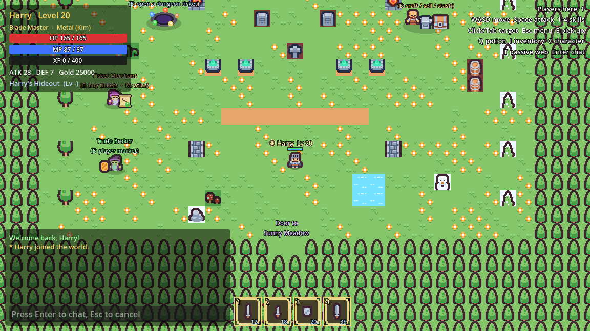 | 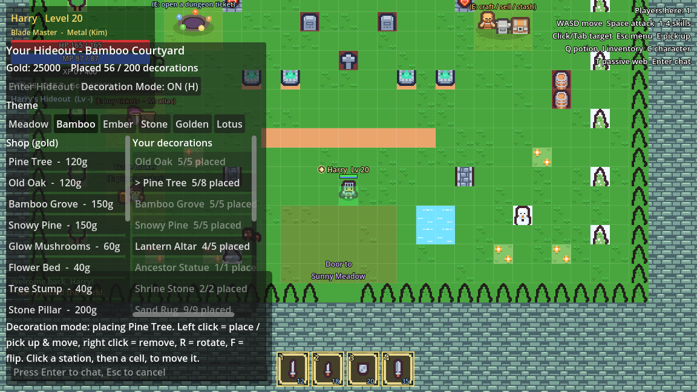 | 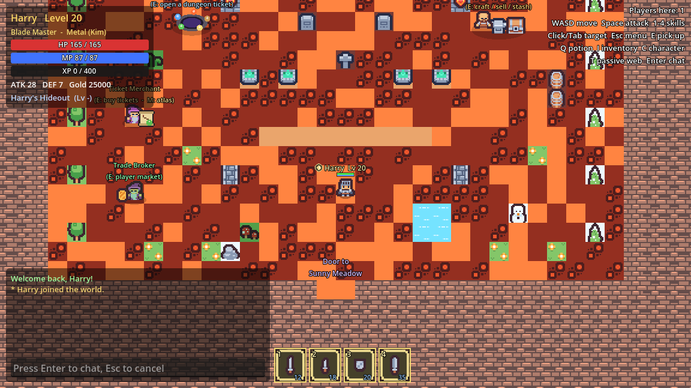 |

Code: `scripts/hideout.gd` (catalog, themes, layout data and the pure validation used by both server and client), `scripts/hideout_server.gd` (the zones, requests and RPCs), `scripts/hideout_ui.gd` (the panel and decoration mode), plus small hooks in `zone.gd`, `zone_map.gd`, `instances.gd`, `player.gd` and `main.gd`. Screenshots: `tools/hideout_screenshots.sh`.

## Trade market (Trade Broker, asynchronous auction house)

Players trade items for gold through the **Trade Broker** NPC in Sunny Meadow (south-west of the
Ticket Merchant, press **E** next to him). It works like an auction house: sellers don't have to be
online when their item sells.

| Browse with filters (+ full item tooltip) | Listing an item | My Listings / claim box |
|---|---|---|
| 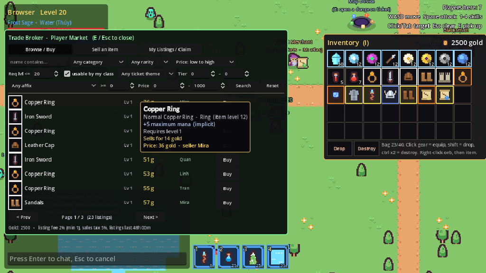 | 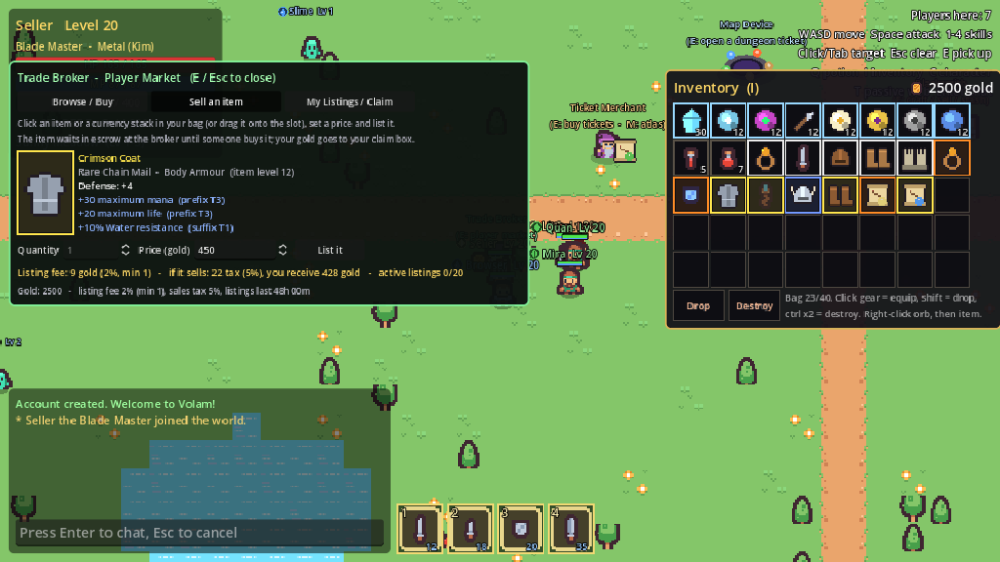 | 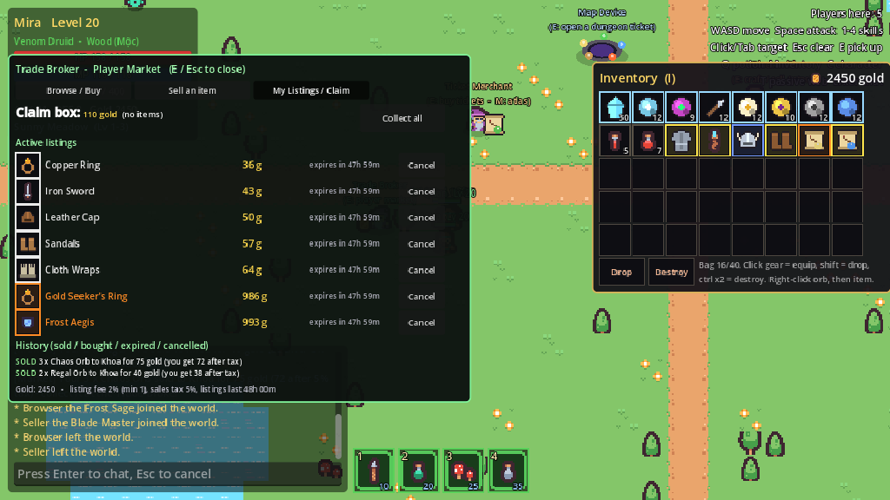 |

* **Sell tab.** Click an item or a currency stack in your bag (or drag it onto the slot), pick the
  quantity (stacks), set a price (1 - 10,000,000 gold) and press *List it*. You pay a **listing fee of
  2% (min 1 gold)**, a gold sink, and the item leaves your bag into **server escrow**.
  You can have **20 active listings** per account. A listing lasts **48 hours (real time)**.
* **Browse tab.** Filters: name text, category/slot (weapon … ring, Dungeon Ticket, currency),
  rarity, max required level, *usable by my class*, ticket theme + tier range, an affix stat with a
  minimum (for example *Fire resistance >= 20*; all-res counts toward each element), and price range.
  Sort by price (low/high) or newest. 8 results per page with Prev/Next. Hover the icon for the full tooltip.
* **Buy** is an instant buyout. The server checks your gold and bag space, moves the item into your bag
  and credits the seller with the price minus a **5% sales tax** (also a sink) into the seller's
  **claim box**. If the seller is online they get a chat notice. Buying your own listing is refused.
* **My Listings / Claim tab.** Cancel a listing (the item comes back to your bag, or to the claim box if
  your bag is full). *Collect all* moves the claim box (gold from sales, expired items) into your bag.
  The history shows what you sold, bought, cancelled and what expired.
* **Expiry.** An expired listing goes back to the seller's claim box. If you were offline when something
  sold or expired, you get a chat message the next time you log in.
* **Untradeable items.** Items with the `bound` flag can't be listed. The starting gear of every new
  character and the Ticket Merchant's free daily ticket are account-bound. The tooltip says
  "Account-bound (can't be traded)". Gold itself isn't an item, and stackables can't be bound.

### How it's built (and why it can't duplicate items)

* `scripts/market.gd` holds the shared rules: fee/tax, tradeability, filters, sort and paging, and
  save validation. `scripts/market_server.gd` is the server node: requests, escrow, claim boxes,
  expiry, login notices and the RPCs to the owner. `scripts/market_ui.gd` is the panel.
* Everything is **server-authoritative**. Clients send requests (`list`, `buy`, `cancel`, `claim`,
  `browse`, `mine`), and only `browse`/`mine` work away from the broker.
* **Races.** Requests are handled one at a time on the server's main thread, and a buy has no `await`
  in it. When two buyers hit the same listing, the first removes it and the second gets
  "that listing is gone". The test fires two bots at one listing in the same second.
* **Persistence and no duplication.** The market (listings in escrow, claim boxes, history) is saved
  to its own file, **`user://volam_save/market.json`**, next to `accounts.json`. With a custom
  `--save-file=X.json` it is `X_market.json`, and `--market-file=PATH` overrides it. Every
  list/buy/cancel/claim/expiry is committed immediately, in this order:
  1. `market.json` is written atomically (temp file + rename) with a new transaction number and a
     **journal**: the post-trade character data of the players involved (buyer, online seller).
  2. `accounts.json` is written atomically, stamped `"market_tx"` with the same number.

  If the server dies between the two writes, the next start sees `accounts.json` behind `market.json`
  and replays the journal into the characters before anyone can log in. So a crash can't leave an item
  both in escrow and in a bag, and it can't take the buyer's gold without delivering the item (or the
  reverse). The test suite kills the server with `kill -9` right after a trade, and with
  `--market-crash-test=buy` it makes the server kill itself *exactly between* the two writes. Both
  times it restarts the server and audits that no item uid exists twice and that gold is conserved
  (fees and tax are the only sinks). `tools/market_audit.py` does the audit.
  Saves from the in-progress build that kept the market inside `accounts.json` are migrated on load.
* Market data loaded from disk is validated (`Market.sanitize_data`) like characters are.

## Project layout

```
project.godot          Godot 4.2 project ("Project Volam", Compatibility renderer)
scenes/main.tscn       The only scene (root node "Main")
scripts/main.gd        Menu, HUD, chat, networking, login/accounts, zone transfers, saving, test bot
scripts/market.gd      Trade market rules: fee / tax, tradeability, search filters, sort + paging, save validation
scripts/market_server.gd Trade Broker server: listings in escrow, buy / cancel / claim box / expiry, atomic commits
scripts/hideout.gd     Hideout data: decoration catalog, themes, layout + placement validation
scripts/hideout_server.gd  Hideout zones (one private instance per account), requests, RPCs
scripts/hideout_ui.gd  Hideout panel + decoration mode (grid overlay)
scripts/market_ui.gd   Trade Broker panel: Browse / Sell / My Listings + claim box
scripts/zones.gd       Zone definitions: sizes, core offsets, names, levels, portals, NPC cells, monster groups, boss lairs
scripts/zone.gd        One zone: map + entity containers + spawners + visibility filters, monster groups (spawn/respawn/patrol), loot drops
scripts/minimap.gd     HUD minimap + N full zone map
scripts/zone_map.gd    Tile map (TileMap) generation for each zone (big overworld: terrain, core, sites, roads, lairs), collision, reachability, A*
scripts/tiles.gd       GENERATED tile atlas constants (by tools/build_assets.py)
scripts/player.gd      Player: input -> server, movement, combat, HP/mana/XP/levels, buffs, inventory, portals
scripts/classes.gd     The 5 classes (stats, growth, skills) and the element cycle / multipliers
scripts/skill_caster.gd Server-side skill logic (checks, target validation/aiming, hit detection, effects)
scripts/talents.gd      Passive web: node graph generation, allocation/refund rules, skill modifiers
scripts/stats.gd        Central stat/modifier aggregation (passive web + gear affixes)
scripts/talent_ui.gd    Passive web panel (T): pan/zoom view, tooltips, refund/reset
scripts/fx.gd          Client-side skill visual effects (rings, bursts, roots, rain, meteor...)
scripts/class_select_ui.gd  Class selection screen
scripts/character_sheet.gd  Character sheet (C)
scripts/element_wheel.gd    The Ngũ Hành diagram drawn on the character sheet
scripts/skill_bar.gd   HUD skill bar (icons, cooldown sweep, mana cost, lock)
scripts/monsters.gd    Monster database (stats, behaviours, loot tables)
scripts/monster.gd     Generic monster: server AI for every behaviour + boss specials
scripts/projectile.gd  Arrows / magic bolts / player spells (Fireball, Ice Shard, Tidal Wave...)
scripts/pickup.gd      Loot lying in the world
scripts/items.gd       Item database: stackables (potions, orbs), gear BASES, UNIQUES, equipment slots
scripts/gear.gd        Gear instances: rarity, affix pools/tiers, loot rolls, orbs, enhancement, tooltips, migration
scripts/inventory_ui.gd Inventory window (paper doll + 40-slot bag, drag & drop)
scripts/item_slot.gd   One item slot (icon, rarity frame, stack count, +N, drag & drop)
scripts/item_tooltip.gd Floating item tooltip with "compared to equipped"
scripts/blacksmith_ui.gd Blacksmith panel: orbs, enhancement, selling, shared stash
scripts/dungeons.gd    Dungeon tickets, themes, map mods, IIQ/IIR, atlas math, procedural layouts
scripts/instances.gd   Server-side dungeon runs: merchant, Map Device, portals, completion, cleanup
scripts/map_ui.gd      Ticket Merchant / Map Device panel
scripts/atlas.gd       Atlas map nodes/paths/unlock rules, bonus objectives, atlas points, passive tree, effects, migration
scripts/atlas_ui.gd    Atlas panel (M): pannable/zoomable map + atlas passive tree
scripts/accounts.gd    Account store: salted SHA-256 passwords + JSON persistence
scripts/net_util.gd    Helpers: MultiplayerSynchronizer configs, smoothing, floating text
assets/                Game textures (built from assets/kenney/ by tools/build_assets.py)
tools/build_assets.py  Rebuilds the textures from the Kenney sheets (Python 3 + Pillow)
tools/build_dungeon_icons.py Draws the ticket / chisel icons and the merchant sprite
tools/market_screenshots.sh Regenerates docs/market_*.png (needs a display)
tools/market_audit.py   Test helper: no-duplication (item uid) + gold-conservation audit of a save after market trades
tools/build_gear_icons.py Draws the gear / orb icons (and cuts the anvil + chest from Kenney sheets)
export_presets.cfg     Linux / Windows / Web export presets
run_local_test.sh      Headless end-to-end test (server + bots, prints PASS/FAIL)
CREDITS.md             Art credits and licenses
docs/                  Screenshots
```

## Open it in Godot

1. Install **Godot 4.2.1** (standard build, not .NET) from https://godotengine.org/download/archive/4.2.1-stable/.
2. Start Godot, click **Import**, pick `project-volam/project.godot`, then **Import & Edit**.
3. Press **F5** (Play). The main menu shows up.

### Try multiplayer on one computer
* In the editor go to **Debug → Run Multiple Instances → Run 2 Instances**, then press F5.
* In window 1, type a name and click **Host (listen server)**.
* In window 2, type another name and click **Join** (the address is already `127.0.0.1`).

### Play with friends
* The host clicks **Host**, or runs a dedicated server (see below). The host has to allow
  **UDP port 7777** through their firewall and forward it on the router if friends join over the internet.
* Friends type the host's IP in *Server address* (you can also write `ip:port`) and click **Join**.

## Command-line options

Put game options **after `--`** (`godot` is the Godot 4.2.1 binary, or use the exported game binary):

```bash
# Dedicated headless server on port 7777
godot --headless --path project-volam -- --server
# Exported build:
./ProjectVolam.x86_64 --headless -- --server --port=7777

# Client that connects straight away
godot --path project-volam -- --join=127.0.0.1 --name=Harry --password=secret

# Listen server that starts straight away
godot --path project-volam -- --host --name=Harry --password=secret

# WebSocket server for browser players
godot --headless --path project-volam -- --server --ws
```

| Option | Meaning |
|---|---|
| `--server` | dedicated server (no local player) |
| `--host` | listen server (host and play) |
| `--join=ADDR[:PORT]` | connect immediately |
| `--port=N` | port (default 7777) |
| `--name=NAME` | account / player name (max 16 chars) |
| `--password=PW` | account password |
| `--save-file=PATH` | server: account save file (default `user://volam_save/accounts.json`) |
| `--debug-loot` | server: 3× drop chances (testing) |
| `--class=NAME` | any client: class to pick automatically when asked (bots, headless, screenshots) (`metal`, `wood`, `water`, `fire`, `earth`) |
| `--bot-no-skills` | bot only uses the basic attack |
| `--open-sheet` | open the character sheet once in game (screenshots) |
| `--debug-start-level=N` | server: brand-new accounts start at level N with some potions (testing) |
| `--fast-respawn` | server: monsters and bosses respawn 10× faster (testing) |
| `--allow-warp` | server: accept warp requests from clients (testing / screenshots) |
| `--warp=ZONE` / `--warp-cell=X,Y` | client: after login ask to be teleported to ZONE (and tile X,Y). Ignored unless the server has `--allow-warp` |
| `--bot-route=forest,crypt,...` | test bot walks (A* pathfinding) through portals to each zone in turn |
| `--bot-dwell=SECS` | how long the bot fights in each zone of its route (default 12) |
| `--bot-hunt=boss` | test bot goes after the zone boss first |
| `--show-fps` | start with the F3 FPS overlay on |
| `--open-zone-map` | open the full zone map (N) once in game (screenshots) |
| `--bigmap-selftest` | offline checks of the big overworld maps: size, reachability, group placement, determinism, old-save positions |
| `--bot-passive` | test bot that never attacks (to test death) |
| `--open-inventory` | open the inventory once in game (screenshots) |
| `--screenshot-delay=SECS` | when to take the `--screenshot` (default 6) |
| `--ws` | use WebSocket instead of ENet (needed for web clients) |
| `--bot` | test bot: hunts monsters, collects loot, drinks potions, equips better gear, says hello |
| `--quit-after=SECS` | quit after N seconds (for automated tests) |
| `--screenshot=PATH` | save a PNG about 6 s after start (needs a display) |
| `--debug-gear` | server: debug-level accounts get a crafting kit (every orb, 30 enhancement stones, 2500 gold, sample gear) |
| `--debug-full-bag=PREFIX` | server: new debug accounts whose name starts with PREFIX start with a full bag (bag-full tests) |
| `--loot-showcase` | server: drops one item of each rarity + some currency in the meadow when the first player logs in (screenshots) |
| `--bot-craft` | test bot runs the scripted crafting / enhancement / vendor / stash sequence at the blacksmith |
| `--bot-no-gear` | test bot never equips gear |
| `--bot-idle` | test bot stands still and does nothing (screenshots) |
| `--gear-selftest` | run the offline gear self-test (drop statistics, IIQ/IIR, item-level gating, orbs, enhancement odds, resistances) and quit |
| `--instance-timeout=S` / `--complete-timeout=S` | server: close empty / completed dungeons after S seconds (defaults 90 / 60) |
| `--debug-next-tier=P` | server: chance (0-1) that a boss ticket is the next tier (default 0.5) |
| `--debug-fresh=PREFIX` | server: new accounts whose name starts with PREFIX ignore `--debug-start-level` (start at Lv 1) |
| `--bot-dungeon=full\|die\|enter\|intrude` | test bot runs a dungeon scenario (buy/craft/open/clear, die until the portals run out, enter and leave, try someone else's portal); `--bot-dungeon-theme=fire`, `--bot-dungeon-tier=N`, `--bot-dungeon-unique` |
| `--open-map-ui=merchant\|device` / `--open-atlas[=map\|tree][@node]` | open the dungeon panel / atlas once in game (screenshots; `@node` forces that node's tooltip) |
| `--hideout-debug` (server) / `--bot-hideout=1\|2` / `--hideout-shot=mode` | Hideout tests: every theme except Lotus Lake unlocked, bosses always drop a decoration, and a `debug_gold` request is allowed / hideout test bot (first session, after a restart) / screenshot setup |
| `--menu-test` / `--menu-test-leave=menu\|quit` / `--open-menu=SECS` / `--settings-test` / `--settings-file=PATH` | Esc menu + pause test driver / open the menu after N s / settings round-trip test |
| `--bot-atlas` (with `--bot-dungeon=full`) / `--debug-atlas-kit` | atlas test bot script / server hands the bot a locked-node ticket |
| `--decor-drop-chance=0..1` (server) | Overrides the boss decoration drop chance (default 8%, 100% with `--hideout-debug`) so the drop test is deterministic |
| `--bot-guardian=fire:10` (with `--bot-dungeon=full`, server `--debug-atlas-kit`) | Guardian test bot: asks for a debug ticket of that atlas node (the server marks the node before it completed), runs it to the end |
| `--bot-watch-patrol` (server `--allow-warp`) | Bot warps next to a meadow patrol route (inside monster activation range, outside aggro range) and stands still; the server logs `patrol #id ... reached site k/N` |
| `--menu-hideout-test` (client) | Opens the Esc menu and clicks its Hideout button with real mouse events, then logs whether the client ended up in its hideout |
| `--market-duration=S` / `--market-max-listings=N` | server: listing lifetime in seconds (default 48 h) / active listings per account (default 20) |
| `--market-short=PREFIX` | server (test): listings of accounts starting with PREFIX expire after 15 s |
| `--market-file=PATH` | server: market save file (default `user://volam_save/market.json`, or `X_market.json` next to a custom `--save-file=X.json`) |
| `--market-crash-test=buy` | server (test): kill itself right after writing market.json for the first buy, before accounts.json (crash-recovery test) |
| `--bot-market=ROLE` | test bot walks to the Trade Broker and runs a market script (seller, buyer, race, pauper, fullbag, expirer, collector, qbuyer, stocker, onebuyer) |
| `--open-market=browse[:filters]\|sell\|mine` / `--open-market-at=S` / `--market-tip` | open the market panel on a tab once in game (screenshots); `tools/market_screenshots.sh` regenerates the three market screenshots |
| `--open-smith` / `--debug-tooltip=N` | open the blacksmith panel / show the tooltip of bag slot N once in game (screenshots) |

Headless end-to-end test (about 14 minutes). It runs a server with bots in thirteen phases (with
restarts in between) and prints PASS/FAIL for damage, death/respawn, XP/level-up,
loot/pickup/potion/equip, account create/login/wrong-password/duplicate rejection, save/restore
(including the zone), zone travel through every portal in both directions, zone visibility
isolation, every monster type attacking/dying/respawning, and all three bosses (special attacks,
kill, loot, chat announcement, respawn), classes/skills/status effects, targeting, the passive web, the trade market (listing fee + escrow, every search filter, buy with tax, self-buy / no gold / full bag / max listings / bound item rejected, two buyers racing one listing, cancel, expiry, claim box, offline seller paid on next login, persistence across restart, a kill -9 crash test, a crash exactly between the market.json and accounts.json writes, the free daily ticket refused, and a no-duplication / gold-conservation audit), the dungeon endgame (merchant, free ticket, ticket crafting, Map Device, private instances and their isolation, portals, death, boss completion, next-tier drops, map mods, IIQ/IIR on drops, atlas persistence, cleanup), hideout rewards (an Atlas Guardian kill unlocks its element's theme without any unlock-all flag, a boss decoration drop with a forced chance lands in the saved owned decorations, and the Esc-menu Hideout button clicked through the UI), overworld patrols walking between their sites while a player is in activation range, and the gear system (drops of every rarity, IIQ/IIR, item-level gating, every orb plus its invalid uses, enhancement success/failure/downgrade/gold, equip/unequip stats and resistances, selling, stash, drop/destroy, full bag, migration of old saves, persistence):
```bash
GODOT=/path/to/Godot_v4.2.1-stable_linux.x86_64 ./run_local_test.sh   # ~31 min, 400+ checks (needs python3)
```

## Controls

| Key | Action |
|---|---|
| W A S D / Arrow keys | Move |
| Space | Basic attack (melee within ~56 px, or a bolt for Water/Fire) |
| 1 2 3 4 | Use skill 1-4 (or click the skill bar) |
| C | Character sheet (class, stats, skills, element cycle) |
| T | Passive web (drag to pan, wheel to zoom, click to allocate, right-click twice to refund) |
| Left-click | Select monster/player (empty ground clears) |
| Right-click | Select monster and attack |
| Tab | Cycle nearest enemies |
| Esc | Close the topmost open panel (market, Map Device/merchant, atlas, blacksmith, passive web, character sheet, inventory); with nothing open, open/close the in-game menu |
| Hold 1-4 | Ground skills: aim preview at the cursor, cast on release |
| E | Pick up the nearest item (walking over items also picks them up). Next to the blacksmith anvil: open the blacksmith panel. Next to the Map Device / Ticket Merchant: open the dungeon panel |
| M | Atlas (map of dungeon nodes + atlas passive tree) |
| N | Zone map (big map of the current zone; the minimap is always in the top-right corner) |
| F3 | FPS overlay (FPS, frame ms, monsters received by this client, node count); off by default |
| H | In your hideout: open the hideout panel and toggle decoration mode (left-click place / move, right-click remove, R rotate, F flip) |
| `/hideout` (chat) | Go to your hideout (also **Esc > Hideout** or the Hideout Master in town) |
| I | Open / close inventory |
| Click / drag (inventory) | Click gear to equip / unequip, click a potion to drink. Drag between bag, paper doll, Drop, Destroy, blacksmith slot and stash |
| Shift-click / Ctrl-click ×2 | Drop an item on the ground / destroy it |
| Right-click an orb, then click an item | Use a crafting orb anywhere (enhancement stones only at the blacksmith) |
| Hover an item | Tooltip with affixes, requirements, sell value and a comparison with the equipped item |
| Q | Drink a health potion |
| Enter | Open chat / send message |
| Esc (while typing) | Cancel chat |

## In-game menu (Esc) and pausing

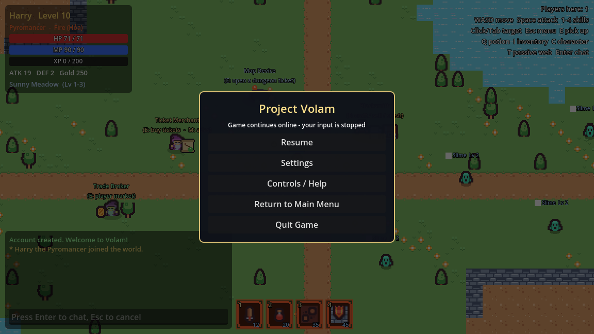

Press **Esc** with no panel open to get the in-game menu: a darkened overlay with a centred panel.

* **Resume** closes the menu (so does Esc).
* **Hideout** takes you to your hideout (not from inside a dungeon). See [Hideout](#hideout-path-of-exile-style).
* **Settings:**
  * master volume slider
  * fullscreen / windowed toggle
  * show damage numbers / floating text toggle

  Settings are saved on the client in `user://settings.cfg` and applied at start-up. The key list is read-only.
* **Controls / Help** lists every key.
* **Return to Main Menu** disconnects cleanly. A host saves everyone first. Then it reloads the title screen.
* **Quit Game** does the same clean save/disconnect, then quits.

Esc priority:

1. Typing in chat: Esc cancels the chat.
2. Otherwise Esc closes the topmost open panel.
3. Otherwise it toggles the menu.

Esc no longer clears the target; click empty ground for that.

**Pausing (multiplayer-aware):**

* **Solo host** (you started with Host and nobody else is connected): the world really pauses (`get_tree().paused`). Monsters, projectiles and timers stop. The menu runs with `PROCESS_MODE_ALWAYS`, and the network peer keeps polling.
  If someone connects while you're paused, the world unpauses for them automatically.
* **Anything else** (other players online, or you are a client of a dedicated server): the menu says *"Game continues online"*. Your movement and skill input stop, but the world goes on. There is no invulnerability.

## Accounts & where saves are stored

* Type an **account name** and **password** in the main menu. The first login creates the
  account on that server; after that the same password is required. Wrong passwords and second
  logins of an account that's already online are rejected with a message in the menu.
  (Names aren't case-sensitive: `Harry` and `harry` are the same account.)
* Accounts live **on the server** (the host's machine for a listen server), in
  `user://volam_save/accounts.json`. On Linux that's
  `~/.local/share/godot/app_userdata/Project Volam/volam_save/accounts.json`. On Windows it's
  `%APPDATA%\Godot\app_userdata\Project Volam\volam_save\accounts.json`.
  Use `--save-file=PATH` to put it elsewhere. Delete the file to wipe all accounts.
  The trade market (escrow, claim boxes) is saved beside it in `market.json`; delete both together.
* Each account entry holds the password hash and salt, `character` (class, level, XP, HP, zone, position, gold,
  currency stacks in `inventory`, gear instances in `equipment` and `bag`, passive-web nodes, `items_v: 2`) and the
  account-wide `stash` (gear instances).
* The server saves when a player leaves, every 30 seconds, and when the server quits normally
  (closing the window, or `--quit-after`). If a dedicated server is killed (Ctrl+C / kill),
  at most the last ~30 s of progress is lost.
* Passwords are hashed with a random per-account salt (SHA-256). That's OK for a prototype, but a
  real game should use a slow password hash (Argon2/bcrypt) in a separate auth service, and TLS.
  ENet traffic isn't encrypted, so don't reuse a real password here.

## Exported builds

Built with the official Godot 4.2.1 export templates (`builds/` next to the project folder):

* **Linux**: `builds/linux/ProjectVolam.x86_64` (single file; `chmod +x` it, then run it. Add `--headless -- --server` for a dedicated server.)
* **Windows**: `builds/windows/ProjectVolam.exe` (single file, double-click. Windows may show a SmartScreen warning because the file is unsigned.)
* **Web**: `builds/web/`. Godot 4.2 web builds need cross-origin isolation headers, so don't just open
  `index.html` from disk. Use `python3 serve.py` in that folder, then open http://localhost:8060/index.html.
  The web client can only **Join**, and only servers started with `--ws`. You can auto-join with
  `index.html?join=SERVER_IP&name=Harry&password=secret`. (When hosted on HTTPS, browsers require `wss://`, so you'd
  need a TLS reverse proxy in front of the server. That's a next step.)

To re-export: install the 4.2.1 export templates (Editor → Manage Export Templates), then
**Project → Export**, or headless: `godot --headless --path . --export-release "Linux" ../builds/linux/ProjectVolam.x86_64`
(presets: `Linux`, `Windows`, `Web`).

## How the networking works (short version)

* The **server is the authority** over the world: it owns every player, monster, loot and projectile node.
* Each zone has `MultiplayerSpawner`s (players, monsters, loot, projectiles) that copy the server's
  spawned nodes to clients. We use a `spawn_function`, so nodes are built in code from a small data
  dictionary (id, type, level, position).
* Each entity has a `MultiplayerSynchronizer` that streams `sync_pos` every network tick (unreliable)
  and `hp` / `level` / `alive` etc. only when they change (reliable). Clients smooth toward `sync_pos`.
  Its visibility filter limits all of this to peers in the same zone (interest management per zone).
* Clients send RPCs to `Main` (a path that never changes, even mid zone-change):
  `player_request(action, arg)` for input/attack/pickup/use/equip, `submit_chat(text)`,
  `register_player(name, password)`. The server looks up the sender's own character from the peer
  id, so a client can only steer its own character.
* Maps come from fixed seeds, so each machine generates the same maps locally and they never go over the network.

## Next steps toward a real MMO

Done so far: player HP/levels, loot & inventory, simple accounts with saving, real pixel art,
four big 200x128 zones with monster groups and per-zone + distance interest management, 13 monster types and 3 bosses, five elemental
classes with skills, mana, status effects and the element cycle.

1. **Real accounts & database**: move login to a separate auth service (REST API, Argon2
   password hashes, session tokens, TLS) and swap the JSON file for PostgreSQL or SQLite.
   Keep the game server as the only writer of character data.
2. **More gameplay**: NPC shops (sell Slime Gel!), quests, skill trees / skill levels, PvP using the element cycle, item rarity,
   stackable item limits, trading between players, parties (shared boss credit already works).
3. **Better netcode**: client-side prediction and reconciliation (movement feels instant at
   high ping), finer interest management (today: per zone, plus a distance filter for overworld monsters),
   rate limiting, and more input validation.
4. **Zone servers / sharding**: today one server process runs every zone. Next is one process
   per zone (or per group of zones) behind a gateway that hands characters (with their saved data)
   from one server to another at the portals.
5. **Dedicated server hosting**: export a `dedicated_server` preset, run it on a Linux VPS as a
   systemd service or Docker container, open UDP 7777, add a TLS proxy for `wss://` web clients,
   and back up the save file/database.
6. **Content & tools**: hand-paint maps in the TileMap editor, animated sprites, sound and
   music, a minimap.

## Known limitations

* No client-side prediction yet, so movement has a tiny delay (one round trip). Fine on LAN, noticeable at high ping.
* Players don't collide with each other or with monsters (on purpose, to keep it simple).
* All zones run in one server process (they're isolated for clients, but CPU-wise it's one server).
* Monsters don't path-find: walking monsters chase in a straight line and can get stuck behind
  trees (flyers and ghosts don't care). Bosses reset if you pull them far from their lair.
* There's no level gate on portals: a level-1 character can walk into the Frostpeak Ruins (and will regret it).
* The Kenney Tiny packs have no wolf or skeleton sprites, so the pack hunters are **Dire Rats** and
  the crypt's ranged enemies are hooded **Crypt Archers** instead of skeletons. The Ice Ogre,
  Frost Bat, Broodmother, Lich King and some forest/crypt/snow tiles are tinted versions of Kenney sprites.
* Character sprites are single frames (they flip left/right and waddle when walking). There are no
  walk-cycle animations, because the Kenney Tiny packs only have one frame per character.
* There's no death penalty. Dropped items can be picked up by anyone in the zone. There's no trading between players yet.
* A server runs either ENet *or* WebSocket, not both at once.
* Classes: there's no class change (passives can be refunded or reset for gold, but to try another class you need a new
  account). Mouse targeting was tested with bots sending the same requests the mouse produces. The click
  handling itself was checked by hand in screenshots, not with an automated test. Players can't
  hurt each other (no PvP), so the element cycle only matters against monsters. Balance has
  only been tried with bots, not people. The Wood/Water/Fire sprites are tinted Kenney characters,
  and skill effects are simple drawn shapes (no particle textures or sound).
* Passive web: there's one fixed web layout (generated in code, deterministic). Class skill notables in another class's region do nothing for you (the tooltip says
  which class they're for). The web view is drawn with simple shapes, so there are no per-node icons.
* Mouse targeting: the server side (target id / cursor validation, range, line of sight, zone) is covered by the bot tests,
  which send the same requests the mouse does. Actual clicking was only tried by hand.
* Cooldowns survive zone changes but not logging out. Buffs, shields and damage-over-time end when you change zones.

* Dungeons:
  * Runs are solo (no parties yet).
  * The themes reuse the existing Kenney tiles and monsters with a colour tint (Ember Caverns are red-tinted caves, the Metal Forge uses steel-tinted stone). There are no new tile art or monster sprites.
  * The five dungeon bosses are scaled-up, recoloured versions of existing sprites with the Quake / Charge-style specials of the overworld bosses.
  * The Atlas map is a progression graph (you open nodes with tickets at the Map Device); it is not a world you walk across.
  * The Map Device and merchant UI were checked in screenshots; the bots drive the same server requests.
  * Balance (pack sizes, drop rates, prices) has only been tried with bots.
* Gear: the stash holds gear only (currency and potions stay in the bag). There's no trading, no item-level display on
  monsters, and no orb that adds a specific affix (no crafting bench). Rare names come from a small word list. The ground
  beam and drop chime are simple drawn shapes and a generated tone. Balance (drop rates, affix ranges, enhancement odds) has
  only been tested statistically with bots. Drag & drop and tooltips were checked in screenshots; the automated tests
  drive the same server requests the UI sends.


## Credits

Art by **Kenney** (www.kenney.nl): "Tiny Town", "Tiny Dungeon", "Tiny Ski" and "Tiny Battle", all **CC0**.
See [CREDITS.md](CREDITS.md).
